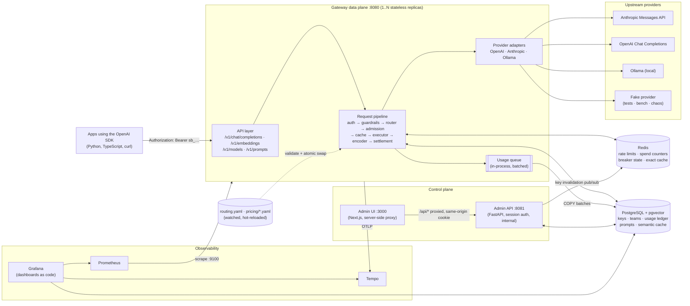

# Switchboard: implementation plan

**Status:** approved 2026-11-27. **Progress:** Phases 0–4 complete. The Phase 1 decision gate (§0.1) is still open: it needs a benchmark run on a quiet machine. Phase notes are in §20. You chose Python, a Next.js admin UI and the repo name `llm-gateway`, and left the other open questions to me; §20 records how I resolved them. Measured results live in `bench/results/` and the ADRs, each with the command that produced it. Every other number in this file is a provider fact (with a source), a config default, or an explicit *target*.

Switchboard is a self-hostable LLM gateway. Apps call one OpenAI-compatible endpoint with a virtual key. The gateway:

- routes each request to a provider and model
- retries and falls back when a call fails
- caches responses
- enforces budgets and rate limits
- records tokens, cost and latency for every call

---

## 0. Decisions at a glance

These are the defaults. The ones marked **(decided)** were open questions; §20 records the outcome.

| Area | Default | Why |
|---|---|---|
| Language **(decided: Python)** | Python 3.14 (`requires-python >=3.14`); uv, FastAPI, httpx, Pydantic v2, uvloop, orjson | See §0.1. This is an application with one pinned runtime, not a library, so it needs no version floor or matrix. Python 3.14 also provides `uuid.uuid7()` natively. |
| Canonical request format | OpenAI Chat Completions schema, used internally as the IR | The ingress is OpenAI. The OpenAI adapter stays near pass-through, so only Anthropic and Ollama need translation (ADR-0002). |
| Upstream calls | Every upstream call streams. Non-streaming clients get an aggregated response. | One code path for timeouts (idle detection), TTFT metrics and pre-first-token fallback (ADR-0003). |
| Process model | One async process per container, scaled by adding replicas. All shared state lives in Redis or Postgres. | No Prometheus multiprocess workarounds, and replicas are interchangeable. |
| Data plane / control plane | Gateway: `:8080` (API, `/health`, `/ready`) and `:9100` (`/metrics`). The admin API is a separate Python process on `:8081`, same image, internal network only. The Next.js admin UI runs on `:3000` and is the only admin surface a browser reaches. | The admin surface and metrics are never exposed on the public port. Business logic stays in one language. |
| Host ports (compose) | All bound to `127.0.0.1`, overridable in `.env`. Defaults sit in a 7xxx block (gateway `7080`, admin UI `7081`, Grafana `7300`, Prometheus `7090`, Postgres `7432`, Redis `7379`). | The common ports (8080, 5432, 6379, 3000) are often taken; on the dev box 8080 already is. |
| DB access | asyncpg with plain-SQL migrations and a small in-repo runner. Usage is written with `COPY`. | Reviewers can read the SQL directly, and there is no ORM on the hot path. |
| Redis | Redis 8, using core commands and Lua only (so Valkey also works) | Rate limits, spend counters, circuit-breaker state and the exact cache. |
| Vector store | pgvector in the same Postgres | One less service. Semantic-cache lookups are filtered by tenant and context anyway. |
| Tracing backend | Grafana Tempo (over Jaeger) | Traces appear inside Grafana, and metric exemplars link straight to traces. |
| Admin UI **(decided: Next.js)** | Next.js (App Router) + TypeScript strict, pnpm, Tailwind + shadcn/ui, Recharts, TanStack Query. Its TS types are generated from the admin API's OpenAPI schema. | See §13. The UI is a thin client: all business logic and auth stay in the Python admin API. |
| Load tool | k6 + the `xk6-sse` extension (pinned commit, built in Docker) | Measures TTFT on SSE at hundreds of VUs. llama.cpp's server bench uses the same approach. A Python fallback is described in §19. |
| Deployment | Docker Compose plus a documented single-VM deploy with Caddy (Helm listed as next step) | Can be tested end to end on one machine. |
| Key storage | HMAC-SHA256(server pepper, key). Keys are 256-bit random. | A slow KDF such as argon2 is meant for low-entropy passwords and would add tens of ms to every request. Argon2id is used for admin passwords only. |
| Money | `Decimal` in Python, `NUMERIC(18,9)` in Postgres, integer nano-USD in Redis | No float drift, and Redis counters stay atomic integers. |
| Config | `config/routing.yaml` (hot-reloaded) and `config/pricing/<date>.yaml` (versioned), validated by Pydantic plus semantic checks | Config lives in git. The admin UI only shows it. |
| License **(decided)** | Apache-2.0 | Includes an explicit patent grant; standard for infrastructure projects. |

### 0.1 Python vs Go (decided: Python, with the Phase 1 gate)

I don't think Go is *clearly* better here, and you chose Python. The honest trade-off:

- **Go's case.** Per-chunk CPU cost and per-connection memory are lower. Goroutines make 500+ concurrent streams trivial, and a static binary is simpler to ship. Several newer gateways are written in Go or Rust for this reason. Go would very likely post better absolute overhead numbers.
- **Python's case.**
  - The workload is I/O-bound. Upstream TTFT is hundreds of milliseconds to seconds, and the gateway's job is to add single-digit milliseconds. That is achievable in Python with discipline: uvloop, orjson, no Pydantic validation per stream chunk, pooled connections and one Redis round trip for admission.
  - Horizontal scaling is trivial because all shared state is external.
  - The translation layer is mostly JSON reshaping, which is quick to write and test in Python.
  - Most people reviewing AI infrastructure read Python fluently.
  - It is the stack you asked for.
- **Decision gate.** Phase 1 measures overhead on a thin end-to-end slice before any features exist. My target is p99 added TTFT ≤ 25 ms at 200 concurrent streams for one gateway process on the bench box. If we miss it badly, we stop and choose between optimizing the hot path and switching to Go before the codebase grows. The 25 ms is a target I chose, not a measurement.

---

## 1. Architecture



### 1.1 Module boundaries (`src/switchboard/`)

| Package | Responsibility | Depends on |
|---|---|---|
| `api/` | FastAPI routers, OpenAI error envelope, SSE writer, size limits, request IDs | everything below via the pipeline |
| `schemas/` | OpenAI-compatible request/response models (the IR), normalized stream events | nothing |
| `routing/` | Config models, loader and validation, rule engine, A/B selection, capability filter → `RoutePlan` | `schemas` |
| `reload.py` | The active routing snapshot (table + adapters) and hot reload: content watch, `SIGHUP` (ADR-0013) | `routing`, `providers`, `reliability` |
| `providers/` | `ProviderAdapter` protocol, OpenAI / Anthropic / Ollama adapters, the upstream HTTP transport (`http.py`, aiohttp, ADR-0012), SSE decoding, error classification, the thinking sidecar (`thinking.py`, ADR-0009) | `schemas`, `routing` (config and target types only), a Redis client for the sidecar |
| `reliability/` | Executor (timeouts, retries, fallback, hedging, refusal fallback), the failure table, circuit breakers (Redis + in-process, ADR-0004), backoff, retry and hedge budgets, the idle watchdog | `providers`, `routing`, Redis |
| `cache/` | Key normalization, exact cache (Redis), semantic cache (pgvector), stream replay | `storage`, `providers` (embeddings) |
| `auth/` | Key format, hashing, lookup, in-process key cache, invalidation listener | `storage` |
| `limits/` | Token buckets (RPM/TPM), budget reservation and settlement (Lua) | `storage` |
| `accounting/` | Pricing tables, cost calculator, usage events, async batch writer | `storage` |
| `guardrails/` | Pre/post hook protocol, registry, PII redaction example | `schemas` |
| `prompts/` | Prompt registry (versions, labels, rendering) | `storage` |
| `observability/` | Metrics, tracing setup (GenAI semantic conventions), structlog config | nothing |
| `storage/` | asyncpg pool, migration runner, Redis client, Lua scripts | nothing |
| `admin/` | Control-plane JSON API (FastAPI): auth and sessions, teams, keys, usage queries, prompts, routing view, audit log. Publishes an OpenAPI schema for the UI. | `storage`, `routing` (read-only) |
| `cli.py` | `switchboard migrate \| create-team \| create-key \| create-admin \| validate-config \| serve \| serve-admin` | |

`src/fakeprovider/` is a separate package in the same repo, with its own container. It is described in §15.2. `web/admin/` is the Next.js admin UI (§13).

---

## 2. Request lifecycle (`POST /v1/chat/completions`)

```mermaid
sequenceDiagram
    autonumber
    participant C as Client (OpenAI SDK)
    participant G as Gateway
    participant R as Redis
    participant A as Primary (Anthropic)
    participant B as Fallback (OpenAI)
    participant Q as Usage queue → Postgres

    C->>G: POST /v1/chat/completions (stream=true, model="smart")
    G->>G: request ID · size limit · auth (key cache) · validate · guardrails(pre) · route → [A, B]
    G->>R: admission script (RPM/TPM buckets, budget reservation) + breaker states (one round trip)
    R-->>G: allowed; A and B closed
    G->>R: exact-cache lookup
    R-->>G: miss
    G->>A: POST /v1/messages (stream)
    A-->>G: 529 overloaded_error
    Note over G: retryable → full-jitter backoff, retry once
    G->>A: POST /v1/messages (stream)
    A-->>G: SSE error event before any content
    Note over G: nothing committed to client → fall back
    G->>B: POST /v1/chat/completions (stream, include_usage)
    B-->>G: first content delta
    G-->>C: 200 + x-switchboard-* headers + first chunk (commit point)
    loop each upstream chunk
        B-->>G: delta
        G-->>C: chat.completion.chunk
    end
    B-->>G: usage chunk + [DONE]
    G-->>C: usage chunk (only if client asked) + [DONE]
    G->>R: settle: actual cost, release reservation, TPM correction, breaker outcomes
    G->>Q: enqueue usage event (never blocks)
```

The steps in detail:

1. **Ingress.**
   - Accept `X-Request-ID` if it is well formed, otherwise generate a UUIDv7. Start the root span.
   - Enforce the body limit while streaming the body. The default is 8 MiB, and an oversize body gets 413 in the OpenAI error shape.
2. **Auth.**
   - `Authorization: Bearer sb_live_…` is hashed with HMAC-SHA256 and looked up in the in-process key cache (TTL 30 s), falling back to Postgres.
   - Revocations are pushed over Redis pub/sub, so they apply within about 1 s instead of waiting out the TTL.
   - The result is a `KeyContext`: key, team, limits, allowed models and tags. Request tags are added from the `X-Switchboard-Tags` header.
3. **Validate.** Pydantic validates the OpenAI request. Unknown fields are kept (`extra="allow"`) so new OpenAI parameters are not rejected.
4. **Prompt rendering** (optional). If the body has `prompt_ref: {name, version|label, variables}`, the gateway resolves it from the registry and renders it into `messages`. See §12.
5. **Guardrails (pre).** Hooks run in config order and may rewrite the request (PII redaction) or block it (400 with the hook name). They run *before* the cache key is computed, so cache keys never contain the raw PII.
6. **Routing.** The requested `model` is either an alias (`smart`) or a concrete `provider/model`. The router:
   - applies rules (first match wins)
   - picks the primary target with a weighted A/B choice (sticky per key if configured)
   - appends the fallback chain
   - drops candidates that cannot serve the request (tools, images, forced `tool_choice`, `n>1`, JSON schema, context length)

   The output is an immutable `RoutePlan` holding the target list plus per-target timeout and retry policy. If no candidate is left, the client gets a 400 that names the missing capability.
7. **Admission.** One Redis round trip, a pipelined Lua script plus `MGET`, that:
   - takes from the RPM and TPM buckets for the key and the team, using an estimated token count
   - checks hard budgets and reserves the request's estimated cost
   - reads the breaker state of every candidate

   A rejection returns 429. Rate limits use `type: rate_limit_exceeded` with `retry-after` and `x-ratelimit-*` headers. Budget blocks use `type: insufficient_quota` with `x-should-retry: false`, which the OpenAI SDK honours, so the client does not burn retries on a hard budget block.
8. **Cache.** Exact lookup in Redis first. If the route opts in, a semantic lookup in pgvector follows. A hit is answered from cache (replayed as SSE when `stream=true`) and goes straight to step 11.
9. **Execute.** Walk the plan:
   - Skip candidates whose breaker is open.
   - Make an attempt with connect, first-token, idle and total timeouts.
   - On a retryable error, retry the same target with full-jitter exponential backoff, honouring `retry-after` up to a cap and subject to a per-provider retry budget.
   - Otherwise move to the next candidate.
   - Optional hedging: if no first token arrives within `hedge_after`, start the next candidate in parallel. The first to commit wins and the other is cancelled.
10. **Encode and stream.**
    - Adapters emit normalized events (§3.2). One encoder turns them into OpenAI `chat.completion` JSON or `chat.completion.chunk` SSE.
    - Post guardrails run here. Streaming guardrails see text deltas through a holdback buffer.
    - If the client disconnects, the upstream request is cancelled so the provider stops generating billable output.
11. **Settle.**
    - Compute cost from provider-reported usage and the active pricing version.
    - Adjust the spend counters (actual cost minus reservation) and correct the TPM bucket.
    - Report each attempt's outcome to the breaker.
    - Update metrics and span attributes, and write one structured log line with no prompt content.
    - Put the usage event on the in-process queue. The batch writer `COPY`s it to Postgres every 250 ms or every 500 rows.

### 2.1 Streaming commit point (fallback "before the first token")

- **Commit point:** the moment the first content-bearing event (text, tool-call start or refusal) is forwarded to the client. Before it, any failure (HTTP error, SSE error event, timeout, disconnect) can be retried or sent to the next candidate, and the client never sees it. After it, no fallback is possible because partial output has been delivered. The gateway sends an OpenAI-shaped SSE `error` event and closes the stream; the OpenAI SDK raises `APIError` on it.
- **Headers:** response headers are held until the commit point, so a total failure can still return a proper HTTP status and error body. If nothing has committed after `keepalive_after` (default 5 s, relevant for slow-thinking models), the gateway sends `200` with headers and then SSE comment keep-alives (`: ping`) every 5 s. These keep proxies from timing out, and SDK parsers ignore them. Fallback is still possible after this point, because no content has been sent. The only difference is that a total failure is then reported as an in-stream error event.
- **Response headers:** `x-request-id`, `x-switchboard-provider`, `x-switchboard-model`, `x-switchboard-cache` (`MISS|HIT|SEMANTIC_HIT|BYPASS`), `x-switchboard-fallback`, `x-switchboard-attempts`, and `x-switchboard-dropped-params` (see §3.3).

### 2.2 Failure classification

| Upstream outcome | Retry same target | Fall back | Counts toward breaker |
|---|---|---|---|
| Connect/DNS/TLS error | yes | yes | yes |
| Timeout before commit (connect, first token, idle) | yes (once) | yes | yes |
| 429 rate limited (`retry-after` ≤ cap) | yes | yes | yes |
| Quota/spend exhausted (OpenAI 429 `insufficient_quota` and related codes; Anthropic 429 `details.error_code` `enforced_spend_limit_reached` / `contract_spend_limit_reached`, 402 `billing_error`, and the 400 "You have reached your specified API usage limits") | no | yes | yes |
| 500/502/503/504, Anthropic 529 `overloaded_error`, SSE `error` event before commit | yes | yes | yes |
| 401/403 from provider (our credentials are bad) | no | yes | yes, plus an error log |
| 400 context length exceeded | no | only to candidates with larger `max_input_tokens` | no |
| Other 400/404/413/422 | no | no; returned to the client in OpenAI shape | no |
| Request the adapter cannot express for this provider (never sent; Phase 2's `invalid_request`) | no | yes | no |
| Target's breaker is open (no call made) | — | yes | — |
| Refusal (`stop_reason: "refusal"`, HTTP 200) before commit | no | only if the route sets `fallback_on_refusal: true` | no |
| Any failure after commit | no | no; SSE error event | yes, if it was the provider's fault |
| Client disconnect | — | — (upstream cancelled) | no |

An `x-should-retry` response header from the provider overrides the "retry same target" column.

---

## 3. Provider adapters

### 3.1 Interface

```python
class ProviderAdapter(Protocol):
    kind: ClassVar[str]  # "openai" | "anthropic" | "ollama"

    def stream_chat(
        self, req: ChatRequest, target: ModelTarget, ctx: CallContext
    ) -> AsyncIterator[StreamEvent]:
        """Open one upstream streaming call and yield normalized events.

        Raises ProviderError (already classified per §2.2) for failures that happen
        before or during the stream. Must stop promptly when the consumer is closed
        (client disconnect, hedge loser, shutdown) and close the upstream connection.
        """

    async def embed(
        self, req: EmbeddingRequest, target: ModelTarget, ctx: CallContext
    ) -> EmbeddingResult: ...

    def classify(
        self,
        status: int | None,
        body: bytes | None,
        headers: Mapping[str, str] | None,
        exc: BaseException | None,
    ) -> ProviderError: ...


@dataclass(frozen=True)
class CallContext:
    request_id: str
    timeouts: Timeouts  # connect, first_token, idle, total
    attempt: int
    timings: CallTimings  # perf_counter stamps the adapter records for overhead metrics
    # Added with the features that need them: span (Phase 6), sidecar (§3.4, Phase 2).
```

As implemented in Phase 1 (`src/switchboard/providers/base.py`), `stream_chat` returns an `AsyncGenerator`, so the caller can close it deterministically (`contextlib.aclosing`) on disconnect or timeout. `embed` arrives with `/v1/embeddings` in Phase 2. Classification lives next to each adapter (`classify_response`) and in the transport for network errors.

Non-streaming client requests use the same `stream_chat` and are aggregated by `schemas.aggregate()`, so there is only one upstream code path (ADR-0003). Adding a provider means writing one module and one fixtures directory, and registering it in the provider config.

### 3.2 Normalized stream events

```python
StreamEvent = (
    MessageStart(id, served_model)
    | TextDelta(text)
    | ReasoningDelta(text)  # dropped by default; route option exposes it as delta.reasoning_content
    | ToolCallStart(tool_index, call_id, name)
    | ToolCallArgsDelta(tool_index, fragment)  # raw JSON fragment, never parsed per chunk
    | Finish(reason)  # stop | length | tool_calls | content_filter
    | Usage(input, cache_read, cache_write_5m, cache_write_1h, output, reasoning)
)
```

Usage is normalized into explicit buckets. Anthropic reports `input_tokens` excluding `cache_read_input_tokens` and `cache_creation_input_tokens` (split into 5-minute and 1-hour writes), and reasoning in `output_tokens_details.thinking_tokens` (verified in the docs in Phase 2). OpenAI's `prompt_tokens` *includes* `prompt_tokens_details.cached_tokens`. The encoder turns the buckets back into OpenAI `usage`, including `prompt_tokens_details.cached_tokens` and `completion_tokens_details.reasoning_tokens`.

### 3.3 OpenAI ↔ Anthropic translation (Phase 2 scope)

| OpenAI Chat Completions | Anthropic Messages (API version `2026-10-21`) |
|---|---|
| Leading `system`/`developer` messages | Top-level `system`. Later ones stay in place as `role: "system"` messages, which the API accepts right after a user turn and before an assistant turn or the end (verified in Phase 2). Moving them would invalidate earlier thinking. Anywhere else they become a user-turn text block marked `[system]`. |
| `user`/`assistant` text and image parts (`image_url` as data URL or https) | `text` blocks; `image` blocks with base64 or `url` source. Consecutive same-role messages are merged. |
| `assistant.tool_calls[].function.arguments` (JSON string) | `tool_use` block with `input` (object). Invalid JSON returns a 400 naming the call. |
| `role: tool` messages | One `user` message with `tool_result` blocks, merging consecutive tool messages |
| `tools[].function{name, description, parameters}` | `tools[]{name, description, input_schema}` |
| `tool_choice`: `auto` / `none` | `{type: auto}` / `{type: none}` |
| `tool_choice`: `required` / named function | `{type: any}` / `{type: tool, name}`. The capability filter removes Opus 5.5, Sonnet 5.5 and Fable 5.2, which return 400 for forced tool use. |
| `max_completion_tokens` / `max_tokens` | `max_tokens`, which Anthropic requires. If absent, the per-model `defaults.max_tokens` applies. Thinking tokens count against it. |
| `reasoning_effort` (`minimal`/`low`/`medium`/`high`/`xhigh`) | `output_config.effort` (`low`/`medium`/`high`/`xhigh`/`max`). Our own mapping: `none` and `minimal` become `low`; `max` is reachable through `provider_options`. Anthropic's compatibility layer ignores this field. |
| `temperature`, `top_p` | **Rejected with 400 by API version `2026-10-21` on every model.** Default is to drop them and list them in `x-switchboard-dropped-params`. Setting `unsupported_params: error` returns a 400 instead. A provider entry can pin `api_version: "2023-06-01"` for older models that still accept sampling parameters. |
| `stop` | `stop_sequences` |
| `response_format: json_schema` | `output_config.format: {type: "json_schema", schema}` (verified in Phase 2). `json_object` has no equivalent, so the capability filter handles it. |
| `n > 1`, `logprobs`, `logit_bias` | Unsupported; the capability filter removes the candidate, or the request gets a 400 if no candidate is left |
| `seed`, `presence_penalty`, `frequency_penalty` | Dropped and reported in `x-switchboard-dropped-params` |
| `user` | `metadata.user_id` |
| Last message is from the assistant (prefill) | Rejected by Claude 4.6+ models, so it fails early with a 400 |
| `extra_body.provider_options.anthropic` | Merged into the Anthropic request as an escape hatch (e.g. `thinking.display`) |

How Anthropic responses and stream events map back to OpenAI:

- `message_start` gives the id and model. Its usage is a starting snapshot; `message_delta` usage is **cumulative**.
- `content_block_start(text)` and `text_delta` become `delta.content`.
- `content_block_start(tool_use)` becomes `delta.tool_calls[{index: k, id, type: "function", function: {name, arguments: ""}}]`. Here `k` counts tool calls only, not Anthropic block indexes, so the encoder keeps a block-index→tool-index map. Each `input_json_delta.partial_json` becomes a `function.arguments` fragment.
- `thinking` and `redacted_thinking` blocks are kept for the sidecar (§3.4) and not forwarded unless the route exposes reasoning.
- Stop reasons: `end_turn` → `stop`; `max_tokens` → `length`; `stop_sequence` → `stop`; `tool_use` → `tool_calls`; `refusal` → `content_filter`.
- A refusal can arrive mid-stream. Anthropic's docs say to discard partial output, but at that point it has already been forwarded. We end the stream with `finish_reason: content_filter` and log the refusal category.
- `ping` events are ignored. Unknown event types are logged at debug level and ignored, as Anthropic's versioning policy requires.
- An `event: error` before the commit point is classified per §2.2. After the commit point it becomes an OpenAI error event.

### 3.4 Thinking blocks in tool loops (the "thinking sidecar")

Claude Opus 5.5 and Fable 5.2 always think, and that cannot be turned off. Sonnet 5.5 and Haiku 5.5 can reduce it. Within a tool-use turn, Anthropic requires the thinking blocks to be passed back unchanged. If **all** of them are left out, the API accepts the request but "dropping thinking blocks loses the reasoning in them, even without an error". If only *some* are left out, the request can fail the prefix check with a 400. OpenAI-format clients have nowhere to carry these blocks, so a naive translation quietly makes agent loops worse.

What we do:

- When an Anthropic response contains `tool_use`, store the turn's whole `content` array, in order and verbatim, in Redis. The key is (team, sorted tool_use ids) and the TTL is 1 h.
- When a later request ends with tool results, look up the last assistant turn by its tool call ids.
- If the client's echoed text and tool calls match the stored blocks, substitute the stored array. Otherwise send the turn without any thinking blocks: the API accepts that, and only the reasoning is lost.
- The metric `switchboard_thinking_passback_total{result=hit|miss|mismatch}` makes the quality effect visible.
- Prerequisite: translation must be **deterministic** (same OpenAI history → byte-identical Anthropic prefix). That is a tested property.
- `display: "omitted"` is the default on these models, so the stored blocks hold the encrypted `signature` and no readable text. The route option `thinking_passback: off` disables the feature.

### 3.5 OpenAI adapter

- Near pass-through.
- `max_tokens` is rewritten to `max_completion_tokens` (`max_tokens` is deprecated).
- `stream_options.include_usage=true` is always set upstream. The final usage chunk (empty `choices`) is forwarded only if the client asked for it.
- `tool_calls` deltas are passed through by `index`.
- The provider docs say a stream that is cut off may not include the final usage chunk. In that case cost is estimated and the event gets `cost_estimated=true`.

### 3.6 Ollama adapter

- Uses Ollama's OpenAI-compatible `/v1/chat/completions`, `/v1/embeddings` and `/v1/models`, so it reuses the OpenAI adapter with a capability profile: no `tool_choice`, `n`, logprobs or image URLs.
- The docs list `stream_options.include_usage` as supported. If a recorded fixture shows usage is missing in streams, the adapter switches to native `/api/chat` NDJSON. The final object there carries `prompt_eval_count`, `eval_count` and durations, and tool-call `arguments` are objects that must be serialized.
- **Phase 2 decision:** the OpenAI-compatible `/v1` is used (`providers/ollama.py`). Its documented limits are applied: `max_tokens` instead of `max_completion_tokens`, no `tool_choice` (`none` is sent as "no tools"), no `user`, and images only as base64 data URLs.
- Cost is 0 by default (configurable).

### 3.7 Embeddings and models

- `/v1/embeddings` routes through aliases in the same way, for example `embed-default` → `openai/text-embedding-3-small`. Anthropic has no embeddings endpoint.
- `/v1/models` lists the aliases and concrete models the calling key is allowed to use.

### 3.8 Provider facts checked on 2026-11-27 (re-verified when `pricing.yaml` is written)

**Anthropic.** Sources: platform.claude.com/docs/en/about-claude/pricing, /models/overview, /build-with-claude/streaming, /api/errors, /api/migration-2026-10-21, /build-with-claude/refusals-and-fallback, /build-with-claude/thinking.

- **API version.** Current is `anthropic-version: 2026-10-21`. Under it, `temperature`, `top_p` and `top_k` return 400. The key may be sent as `x-api-key` or `Authorization: Bearer`.
- **Current models** (input / output, USD per MTok):
  - `claude-fable-5-2`: $8 / $40
  - `claude-opus-5-5`: $4 / $20
  - `claude-sonnet-5-5`: $2 / $10
  - `claude-haiku-5-5`: $0.10 / $0.50 for prompts ≤100k tokens, $0.50 / $2.50 above that. **The pricing schema therefore needs tiers by prompt length.**
- **Cache pricing.** Cache reads cost 0.05× input on Opus/Sonnet 5.5, 0.025× on Fable 5.2 and 0.1× on other models. 5-minute cache writes cost 1.25× and 1-hour writes 2×.
- **Limits.** All current models have a 1M-token context and 128K max output.
- **Errors.** 429 `rate_limit_error` (the spend-cap variant has no `retry-after`), 529 `overloaded_error`, 500 `api_error`, 504 `timeout_error`. Responses carry `x-should-retry` and `retry-after` headers and a `request-id` header.
- **Refusals** are HTTP 200 with `stop_reason: "refusal"` and `stop_details.category`. They can happen mid-stream.
- **Anthropic's OpenAI-compatibility endpoint** is documented as "not considered a long-term or production-ready solution". It ignores `reasoning_effort`, drops thinking, does not support prompt caching and returns empty usage details. That is why we write a native adapter.

**OpenAI.** Sources: developers.openai.com/api/docs/pricing, the chat completions API reference and streaming-events page, guides/rate-limits, guides/error-codes.

- **Chat Completions status.** Still supported; Responses is recommended for new projects but Chat Completions is not deprecated. `max_tokens` is deprecated in favour of `max_completion_tokens`.
- **Streaming and usage.**
  - `include_usage` adds a final chunk with empty `choices`.
  - Usage carries `prompt_tokens_details.cached_tokens` / `cache_write_tokens` and `completion_tokens_details.reasoning_tokens`.
  - Rate-limit headers are `x-ratelimit-*`, and `Retry-After` may appear on 429 and 503.
  - Quota and billing 429s must not be retried.
- **Example prices** (Standard tier, input / output / cached input, USD per MTok): `gpt-6.2-sol` $2.00 / $10.00 / $0.10; `gpt-6-luna` $0.10 / $0.50 / $0.01; `gpt-5.4-mini` $0.75 / $4.50 / $0.075; `text-embedding-3-small` $0.02. A subagent read these from the pricing page; I re-verify every row when writing `pricing.yaml`.

**Ollama.** Sources: docs.ollama.com/api/openai-compatibility, /api/chat.

- The OpenAI-compatible endpoints support streaming and tools, but not `tool_choice`.
- Native `/api/chat` streams NDJSON and reports `prompt_eval_count` / `eval_count` in its final object.

---

## 4. Routing config (`config/routing.yaml`)

The full reference goes in `docs/ROUTING.md` (Phase 3). This is the shape:

```yaml
version: 1

defaults:
  timeouts: { connect: 2s, first_token: 30s, idle: 30s, total: 600s }
  retry: { max_attempts: 2, base_delay: 250ms, max_delay: 4s, honor_retry_after_up_to: 10s, budget_ratio: 0.2 }
  breaker: { window: 30s, min_requests: 20, failure_rate: 0.5, cooldown: 30s, max_cooldown: 5m, half_open_probes: 3 }
  keepalive_after: 5s

providers:
  anthropic:
    type: anthropic
    base_url: https://api.anthropic.com
    api_key_env: ANTHROPIC_API_KEY        # secrets only ever come from env
    api_version: "2026-10-21"
    unsupported_params: drop               # drop | error
    pool: { max_connections: 1000, keepalive_expiry: 30s }
  openai:
    type: openai
    base_url: https://api.openai.com/v1
    api_key_env: OPENAI_API_KEY
  ollama:
    type: ollama
    base_url: http://ollama:11434
    timeouts: { first_token: 120s }        # CPU inference is slow to start

models:                                    # concrete deployments, addressable as "provider/model"
  anthropic/claude-opus-5-5:
    upstream_model: claude-opus-5-5
    capabilities: { tools: true, vision: true, forced_tool_choice: false, json_schema: true,
                    max_input_tokens: 1000000, max_output_tokens: 128000 }
    defaults: { max_tokens: 8192 }
  anthropic/claude-sonnet-5-5:
    upstream_model: claude-sonnet-5-5
    capabilities: { tools: true, vision: true, forced_tool_choice: false, json_schema: true,
                    max_input_tokens: 1000000, max_output_tokens: 128000 }
    defaults: { max_tokens: 8192 }
  anthropic/claude-haiku-5-5:
    upstream_model: claude-haiku-5-5
    capabilities: { tools: true, vision: true, forced_tool_choice: true, json_schema: true,
                    max_input_tokens: 1000000, max_output_tokens: 128000 }
    defaults: { max_tokens: 4096 }
  openai/gpt-6.2-sol:   { upstream_model: gpt-6.2-sol }
  openai/gpt-6-luna:    { upstream_model: gpt-6-luna }
  openai/text-embedding-3-small: { upstream_model: text-embedding-3-small, kind: embedding }
  ollama/llama3.2:      { upstream_model: "llama3.2:3b", capabilities: { forced_tool_choice: false } }

guardrails:
  pii_redaction:
    plugin: switchboard.guardrails.pii:PIIRedactor
    config: { entities: [email, phone], apply_to: [request, response] }

aliases:
  smart:
    targets:                               # weighted A/B split picks the primary
      - { model: anthropic/claude-sonnet-5-5, weight: 90 }
      - { model: openai/gpt-6.2-sol,          weight: 10 }
    sticky: key                            # key | end_user | none
    fallbacks: [openai/gpt-6.2-sol, anthropic/claude-haiku-5-5]   # primary is skipped if listed
    cache: { exact: { ttl: 1h } }
  fast:
    targets: [{ model: anthropic/claude-haiku-5-5 }]
    fallbacks: [openai/gpt-6-luna]
    cache: { exact: { ttl: 1h }, semantic: { threshold: 0.95, ttl: 24h } }
  cheap:
    targets: [{ model: openai/gpt-6-luna }]
    fallbacks: [anthropic/claude-haiku-5-5, ollama/llama3.2]
  local:
    targets: [{ model: ollama/llama3.2 }]
  embed-default:
    targets: [{ model: openai/text-embedding-3-small }]

rules:                                     # evaluated top to bottom; first match wins
  - name: research-gets-opus
    when: { team: research, model: smart }
    use: { targets: [{ model: anthropic/claude-opus-5-5 }], fallbacks: [anthropic/claude-sonnet-5-5] }
  - name: sensitive-stays-local
    when: { tags_any: [pii-sensitive] }
    use: { alias: local, guardrails: [pii_redaction] }
  - name: short-prompts-go-fast
    when: { model: smart, prompt_tokens: { lt: 300 }, has_tools: false, has_images: false }
    use: { alias: fast }
```

**Semantics.**

- **Rule match fields:** `model` (requested alias or model), `key` (key name), `team`, `tags_any` / `tags_all` (key tags plus request tags), `prompt_tokens` (`lt`/`lte`/`gt`/`gte`), `has_tools`, `has_images`, `stream`.
- **Rule actions:** `use.alias`, or an inline `targets` + `fallbacks` override, plus optional `cache` and `guardrails` overrides.
- **`prompt_tokens`** is an estimate, `ceil(utf8_bytes / 4)` by default and pluggable. Rules need a cheap number, not an exact tokenizer.
- **A/B selection** is weighted random, or a stable hash of (key id or end user, alias) when `sticky` is set. Tests use a seeded RNG and check the split distribution with a chi-square test.
- **Fallback chains** list concrete models only, so they cannot form cycles. The capability filter applies to every candidate.
- **Validation at startup and on every reload:**
  - schema checks (Pydantic)
  - every reference resolves (models, providers, guardrails)
  - weights are greater than 0
  - every referenced `api_key_env` is set
  - every chat/embedding model has a price in the active pricing file (a warning for `ollama/*`)

  All errors are reported together, each with its YAML path and line number. A failed startup exits non-zero with that list.
- **Hot reload.** Triggered by a content check of the file every second (ADR-0013; it replaced the planned `watchfiles` watch, see the Phase 3 notes), `SIGHUP` (`make reload`), or, from Phase 6, `POST /admin/api/config/reload`. The steps are parse → validate → build an immutable `RoutingTable` → swap one reference atomically. Requests already in flight keep the table they started with. An invalid reload keeps the old table, logs every error and increments `switchboard_config_reloads_total{result="error"}`. The active config hash is exposed as `switchboard_config_info{version}` and in `/ready`.

---

## 5. Reliability

- **Timeouts** apply per provider, with per-model overrides:
  - `connect`
  - `first_token` (attempt start → first content event)
  - `idle` (maximum gap between chunks)
  - `total`

  There is also an overall request deadline that bounds retries and fallbacks together.
- **Retries.**
  - Only for errors classified retryable (§2.2).
  - Full-jitter backoff: `sleep = random(0, min(max_delay, base * 2^attempt))`.
  - `retry-after` is honoured if it is no longer than `honor_retry_after_up_to`; beyond that we fall back immediately.
  - Each provider has a retry budget: retries are capped at `budget_ratio` of recent requests, per process. This stops retry storms when a provider degrades.
- **Circuit breaker.**
  - One breaker per `provider/model`, with state in Redis so that every replica agrees.
  - **Reads cost no extra round trip:** each replica keeps a local view of every breaker, updated from each Lua reply; only an expired open breaker and half-open probing ask Redis (ADR-0004).
  - **Writes are fire-and-forget:** a Lua script updates rolling-window counters (10 buckets per window) and makes transitions atomically.
  - In half-open, an atomic `HINCRBY` on a probe counter gates which requests become probes.
  - If Redis is unreachable, each process falls back to an in-process breaker.

  ```mermaid
  stateDiagram-v2
      [*] --> Closed
      Closed --> Open: failure rate ≥ threshold within window (and ≥ min_requests)
      Open --> HalfOpen: cooldown elapsed
      HalfOpen --> Closed: all probes succeed
      HalfOpen --> Open: any probe fails (cooldown doubles, capped at max_cooldown)
  ```

- **Hedging** (off by default, per route).
  - After `hedge_after` with no first token, the next candidate starts in parallel. There is at most one hedge per request, and hedges are capped at a ratio of requests.
  - The loser is cancelled the moment the winner commits. Its estimated input cost is recorded as `hedge_waste_usd`, because providers may still bill the input of a cancelled request.
  - Metrics: `switchboard_hedges_total{outcome=won|lost|skipped}`.
- **Graceful shutdown.** On `SIGTERM` the gateway:
  1. sets `draining`, so `/ready` returns 503 and the load balancer stops sending traffic
  2. stops accepting new connections
  3. lets in-flight streams finish for up to `shutdown_grace` (25 s)
  4. sends an SSE error event to any stream still open and closes it
  5. flushes the usage queue (up to 5 s)
  6. closes the connection pools

  Compose sets `stop_grace_period: 30s`. An integration test sends `SIGTERM` mid-stream and asserts that the stream completes and its usage row is written.

---

## 6. Caching

- **Exact cache (Redis).**
  - The key is `sha256(canonical_json(scope, primary_target, messages, tools, tool_choice, response_format, generation params))`. Transport-only fields (`stream`, `stream_options`, `user`) are excluded, and defaults are made explicit.
  - **Scope is the team by default**, so one tenant's answers never reach another. `key` and `global` scopes are opt-in per route.
  - The value is the final non-streamed response, its usage, its original cost, the model that served it and a timestamp. It is zstd-compressed and stored with a TTL.
  - Streaming hits are replayed as synthetic chunks, with no artificial delay.
  - Only complete answers are written, meaning `finish_reason` is `stop`, or `tool_calls` when the route sets `cache_tool_calls: true`. Errors, `length`, `content_filter`, `n>1` and hedged duplicates are never cached.
- **Semantic cache (pgvector, opt-in per route, off by default).**
  - The final user turn is embedded through a configured embedding alias.
  - A candidate must match **exactly** on the context fingerprint (system prompt, all earlier turns, tools, response format and target) and be within the cosine-similarity threshold on the final turn. This keeps false hits away from different system prompts or conversation states.
  - It is skipped for requests whose final turn has images or tool results.
  - It uses an HNSW index with pgvector's iterative index scans for filtered queries (version to verify in Phase 5).
  - The embedding dimension is a deploy-time setting (default 1536). Changing it requires `switchboard semantic-cache reset`.
- **Client controls.**
  - `Cache-Control: no-cache` skips the read but still writes.
  - `no-store` skips both the read and the write.
  - `max-age=N` accepts only entries younger than N seconds.
  - Responses carry `x-switchboard-cache` and `age`.
- **Hit rates.**
  - `switchboard_cache_lookups_total{tier, result}` drives Grafana and the admin UI.
  - Each usage event records `cache_status` and `saved_usd` (the original cost of the cached answer). The cost demo uses `saved_usd`.

---

## 7. Keys, budgets, rate limits

- **Virtual keys** look like `sb_live_` followed by base62 of 32 random bytes.
  - The secret is shown exactly once.
  - Postgres stores the HMAC hash and a display prefix (`sb_live_4f2a…`).
  - A key belongs to a team and carries its own optional budget, RPM/TPM limits, allowed models, tags and expiry.
- **Rate limits.** Token buckets in Redis Lua using Redis `TIME`, so there is no clock skew between replicas.
  - **Buckets:** RPM and TPM, each per key and optionally per team.
  - **Atomicity:** one script checks every bucket and only then deducts from all of them. A request rejected by the TPM bucket therefore costs nothing from the RPM bucket.
  - **Estimating TPM:** TPM is charged at admission with an estimate: the prompt estimate plus the request's `max_tokens`, else the model's default, else 4096, capped at the model's `max_output_tokens`.
  - **Correcting TPM:** settlement corrects the bucket with actual usage. A bucket may go into debt, bounded at minus one burst.
- **Budgets.**
  - **Periods:** monthly, by UTC calendar month. Keys and teams each have a **hard** limit (block) and a **soft** limit (alert).
  - **Spend counters:** Redis holds `{spent, reserved}` in nano-USD for each key and team per month. These counters are the real-time source of truth.
  - **Ledger:** Postgres `usage_events` is the durable ledger. A missing counter is rebuilt from the ledger with `SETNX`, so losing Redis loses no spend.
  - **Hard limits use reservations.** Admission checks atomically that `spent + reserved + estimate ≤ hard_limit` and adds the estimate to `reserved`. Settlement removes the reservation and adds the actual cost.
  - **Overshoot bound:** the most a budget can be exceeded by is Σ(actual − estimate) over requests in flight. ADR-0005 documents this, and a property test checks it under simulated concurrency.
  - **Soft limit:** fires once per period and scope, de-duplicated with `SET NX`. It produces a structured log event, the metric `switchboard_budget_alerts_total`, a provisioned Grafana alert rule and an optional webhook (Slack-compatible JSON).
- **Redis failure policy** (configurable): rate limits **fail open**, the cache is **bypassed**, and the breaker falls back to in-process state. Budgets fail open by default, with `budget_on_redis_failure: closed` available for operators who prefer blocking to overspending. Each degraded mode increments a metric and logs at warn level.

---

## 8. Accounting and pricing

- **Pricing file.** `config/pricing/2026-11-27.yaml` is immutable once committed. Every price change is a new file, and the active file is selected in config. Each usage event records `pricing_version`, so past costs can be reproduced.

  ```yaml
  version: "2026-11-27"
  currency: USD
  sources:
    anthropic: { url: https://platform.claude.com/docs/en/about-claude/pricing, retrieved: 2026-11-27 }
    openai:    { url: https://developers.openai.com/api/docs/pricing,          retrieved: 2026-11-27 }
  models:
    anthropic/claude-sonnet-5-5:
      input: 2.00            # USD per MTok
      output: 10.00
      cache_read: 0.10
      cache_write_5m: 2.50
      cache_write_1h: 4.00
    anthropic/claude-haiku-5-5:
      tiers:                 # chosen by the request's total prompt tokens (incl. cache reads/writes)
        - { max_prompt_tokens: 100000, input: 0.10, output: 0.50, cache_read: 0.01, cache_write_5m: 0.125, cache_write_1h: 0.20 }
        - { input: 0.50, output: 2.50, cache_read: 0.05, cache_write_5m: 0.625, cache_write_1h: 1.00 }
    openai/gpt-6-luna: { input: 0.10, output: 0.50, cache_read: 0.01 }
    ollama/llama3.2:   { input: 0, output: 0 }
  ```

- **Cost calculation.** `cost = Σ bucket_tokens × price / 1e6`, computed in `Decimal` from **provider-reported** usage. If usage is missing (an interrupted stream, a hedge loser), the cost is estimated and flagged `cost_estimated=true`.
- **Usage writer.**
  - A bounded `asyncio.Queue` (default 10,000) feeds a background task that batches up to 500 rows or 250 ms and writes them with `copy_records_to_table`. Postgres errors are retried with backoff.
  - The request path only ever calls `put_nowait`. If the queue is full, the event is dropped and `switchboard_usage_events_dropped_total` is incremented. Budgets stay correct regardless, because the Redis counters are updated during settlement.
  - Crash window: a hard crash can lose up to one batch interval of ledger rows. ADR-0006 records this, along with Redis Streams as the durable alternative if you want it.
- **Every request is recorded**, including rejections, errors, cache hits and client cancellations. The fields are listed in §9.

---

## 9. Data model

### 9.1 PostgreSQL (sketch; final DDL lives in `migrations/`)

```sql
CREATE TABLE teams (
  id uuid PRIMARY KEY,
  name text UNIQUE NOT NULL,
  monthly_budget_usd numeric(12,4),          -- hard limit; NULL = unlimited
  soft_budget_usd    numeric(12,4),          -- alert threshold
  rpm_limit int, tpm_limit int,
  allowed_models text[],                     -- NULL = all
  created_at timestamptz NOT NULL DEFAULT now()
);

CREATE TABLE api_keys (
  id uuid PRIMARY KEY,
  team_id uuid NOT NULL REFERENCES teams(id),
  name text NOT NULL,
  key_prefix text NOT NULL,                  -- shown in UI and logs
  key_hash bytea NOT NULL UNIQUE,            -- HMAC-SHA256(pepper, secret)
  status text NOT NULL CHECK (status IN ('active', 'revoked')),
  monthly_budget_usd numeric(12,4), soft_budget_usd numeric(12,4),
  rpm_limit int, tpm_limit int,
  allowed_models text[], tags text[] NOT NULL DEFAULT '{}',
  expires_at timestamptz, revoked_at timestamptz, last_used_at timestamptz,
  created_at timestamptz NOT NULL DEFAULT now()
);

CREATE TABLE usage_events (
  id uuid NOT NULL,                          -- UUIDv7
  created_at timestamptz NOT NULL,
  request_id text NOT NULL, trace_id text,
  key_id uuid NOT NULL, team_id uuid NOT NULL,
  endpoint text NOT NULL,                    -- chat | embeddings
  requested_model text NOT NULL, route_rule text,
  provider text, model text,                 -- what served it (NULL if nothing did)
  status text NOT NULL,                      -- ok | upstream_error | rate_limited | budget_blocked | client_cancelled | guardrail_blocked | invalid_request
  http_status smallint NOT NULL, error_type text,
  stream boolean NOT NULL,
  cache_status text NOT NULL,                -- miss | exact_hit | semantic_hit | bypass | disabled
  fallback_used boolean NOT NULL,
  attempts jsonb NOT NULL,                   -- [{provider, model, outcome, http_status, latency_ms, retry, hedge}]
  input_tokens int, cache_read_tokens int, cache_write_tokens int, output_tokens int, reasoning_tokens int,
  cost_usd numeric(18,9) NOT NULL DEFAULT 0, cost_estimated boolean NOT NULL DEFAULT false,
  saved_usd numeric(18,9) NOT NULL DEFAULT 0, hedge_waste_usd numeric(18,9) NOT NULL DEFAULT 0,
  pricing_version text,
  ttft_ms int, latency_ms int NOT NULL, gateway_overhead_ms real,
  prompt_name text, prompt_version int,
  tags text[] NOT NULL DEFAULT '{}', end_user text,
  PRIMARY KEY (id, created_at)
) PARTITION BY RANGE (created_at);           -- monthly partitions, created ahead by the app; retention drops old ones
CREATE INDEX ON usage_events (team_id, created_at);
CREATE INDEX ON usage_events (key_id, created_at);

CREATE TABLE budget_alerts (scope text, scope_id uuid, period date, threshold text, fired_at timestamptz NOT NULL,
                            PRIMARY KEY (scope, scope_id, period, threshold));

CREATE TABLE prompts (id uuid PRIMARY KEY, name text UNIQUE NOT NULL, description text, created_at timestamptz NOT NULL DEFAULT now());
CREATE TABLE prompt_versions (                -- immutable
  prompt_id uuid REFERENCES prompts(id), version int, template jsonb NOT NULL, variables text[] NOT NULL,
  created_by text NOT NULL, created_at timestamptz NOT NULL DEFAULT now(), PRIMARY KEY (prompt_id, version));
CREATE TABLE prompt_labels (                  -- movable pointers: "production", "staging"
  prompt_id uuid, label text, version int NOT NULL, updated_at timestamptz NOT NULL DEFAULT now(),
  PRIMARY KEY (prompt_id, label), FOREIGN KEY (prompt_id, version) REFERENCES prompt_versions);

CREATE TABLE semantic_cache (
  id bigserial PRIMARY KEY, scope text NOT NULL, context_fp bytea NOT NULL, target text NOT NULL,
  embedding vector(1536) NOT NULL, response bytea NOT NULL, cost_usd numeric(18,9) NOT NULL,
  created_at timestamptz NOT NULL DEFAULT now(), expires_at timestamptz NOT NULL, hit_count int NOT NULL DEFAULT 0);
CREATE INDEX ON semantic_cache USING hnsw (embedding vector_cosine_ops);
CREATE INDEX ON semantic_cache (scope, context_fp, target);

CREATE TABLE admin_users (id uuid PRIMARY KEY, username text UNIQUE NOT NULL, password_hash text NOT NULL,  -- argon2id
                          created_at timestamptz NOT NULL DEFAULT now(), last_login_at timestamptz);
CREATE TABLE audit_log (id bigserial PRIMARY KEY, at timestamptz NOT NULL DEFAULT now(), actor text NOT NULL,
                        action text NOT NULL, target text, details jsonb);   -- every admin mutation
```

### 9.2 Redis keys (all prefixed `sb:`)

| Key | Type | Purpose |
|---|---|---|
| `{t:<team>}:rl:{key:<id>\|team}:{rpm\|tpm}` | hash `{tokens, ts}` | token bucket |
| `{t:<team>}:spend:{key:<id>\|team}:{yyyymm}` | hash `{spent, reserved}` (nano-USD) | budgets (ADR-0005) |
| `{t:<team>}:resv:{key:<id>\|team}:{yyyymm}` | sorted set: `request\|estimate` by expiry | reservations a crashed replica never settled expire |
| `{t:<team>}:alert:{key:<id>\|team}:{yyyymm}:soft` | string, `SET NX` | one soft alert per period |
| `cb:{provider/model}` | hash (state, cooldown, probe counts, a ring of 10 window buckets) | circuit breaker (ADR-0004) |
| `cache:{scope}:{sha256}` | string (zstd), TTL | exact cache |
| `thinking:{sha256(team, tool ids)}` | string, TTL 1 h | thinking sidecar (ADR-0009) |
| `chan:invalidate` | pub/sub | key revocation and team limit changes |

Every limits key of a team shares the hash tag `{t:<team id>}`, so the admission and settlement scripts work on Redis Cluster.

---

## 10. Observability

- **Metrics** (Prometheus, on `:9100`). Labels go down to team, never key, which keeps cardinality bounded. Per-key detail lives in Postgres.

  | Group | Metrics |
  |---|---|
  | Traffic and latency | `switchboard_requests_total{alias,provider,model,status,outcome}` (a `cache` label joins in Phase 5), `switchboard_request_duration_seconds`, `switchboard_ttft_seconds` |
  | Gateway overhead | `switchboard_gateway_overhead_seconds{phase=pre_upstream\|first_chunk_forward}` |
  | Tokens and cost | `switchboard_tokens_total{type}`, `switchboard_cost_usd_total{team,provider,model}` |
  | Cache | `switchboard_cache_lookups_total`, `switchboard_cache_saved_usd_total` |
  | Reliability | `switchboard_attempts_total{outcome}`, `switchboard_fallbacks_total{from,to,reason}`, `switchboard_retries_total`, `switchboard_breaker_state{provider_model}`, `switchboard_hedges_total` |
  | Limits and budgets | `switchboard_ratelimit_rejections_total`, `switchboard_budget_utilization_ratio{team}` |
  | Process internals | `switchboard_inflight_requests`, `switchboard_usage_queue_depth`, `switchboard_usage_events_dropped_total`, `switchboard_config_reloads_total`, plus the standard process metrics (RSS, CPU, open FDs) |

  Histograms carry exemplars with `trace_id`.
- **Tracing.** OpenTelemetry SDK exporting OTLP to Tempo.
  - Spans: request, auth, route, admission, cache, one per upstream attempt (with retry and hedge attributes), encode and settle.
  - Attributes follow the OpenTelemetry GenAI semantic conventions (`gen_ai.request.model`, `gen_ai.usage.input_tokens`, …).
  - Parent-based sampling, 100% in dev and 10% by default otherwise. Benchmarks run at the production default.
- **Logs.** structlog JSON with one line per request: request id, trace id, key prefix, team, alias, provider, model, status, tokens, cost, latency and cache status. **Prompt and response content is never logged by default.** Setting `log_payloads: true` logs it after redaction through the guardrails redactor, with truncation.
- **Grafana** is provisioned from `deploy/grafana/` with four dashboards (JSON committed):
  1. Overview: RPS, errors, latency, TTFT
  2. Cost and budgets: spend by team and model, cache savings, budget utilization
  3. Reliability: fallbacks, breaker states, retries, hedges
  4. Gateway internals: overhead, in-flight streams, queue depth, memory and CPU

  The README gets screenshot placeholders until Phase 8.

---

## 11. Security

- Virtual keys are stored only as HMAC hashes and compared in constant time. The pepper comes from env (`SWITCHBOARD_KEY_PEPPER`), and startup fails if it is missing.
- Provider secrets come only from env and are referenced by name in config. They are never stored, never logged (log processors redact them) and never returned by the admin API.
- **Admin (Next.js UI + Python admin API):**
  - The admin API is a separate process on an internal-only port. Browsers reach it only through the Next.js server-side proxy (`/api/*`), so it is always same-origin: no CORS, and the cookie never leaves the UI's origin.
  - argon2id passwords, created with `switchboard create-admin`.
  - Opaque server-side sessions (random id in Redis, TTL plus idle timeout), sent as an `HttpOnly; Secure; SameSite=Strict` cookie. Logout and revocation take effect immediately.
  - CSRF defence in depth on mutations: `SameSite=Strict`, an `Origin` check, and a required JSON content type plus custom header.
  - Rate-limited login and an audit log of every change.
  - Next.js middleware only redirects unauthenticated users to `/login`. Real authorization is enforced by the admin API on every call.
  - Security headers (CSP, `frame-ancestors 'none'`, `Referrer-Policy`) set in `next.config`.
- Body-size limit, a cap on the number of messages, and per-key `max_tokens` clamps.
- No prompt logging by default (§10). Cache scope is per team by default (§6).
- The gateway never fetches URLs that users send. Image URLs are passed to the provider as they are, so the gateway cannot be used for SSRF. Provider base URLs come only from config.
- **Supply chain:** `uv.lock` pinned; `pip-audit` and `gitleaks` in CI and pre-commit; the image is built from a slim base, runs as non-root with a read-only filesystem, and is scanned with Trivy in CI as a non-blocking report.

---

## 12. Prompt registry and guardrails (smaller scope)

**Prompt registry.**

- Versions are immutable. A version is a list of messages with `{{variable}}` placeholders and declared variables. Substitution is logic-free, with no Jinja, so no template injection is possible.
- Labels (`production`, `staging`) are movable pointers. "Roll forward" means moving a label; "pin" means asking for an explicit version.
- **API:**
  - `GET /v1/prompts/{name}?version=3|label=production` with a virtual key (fetch and render client-side)
  - `POST /admin/api/prompts/{name}/versions`
  - `PUT /admin/api/prompts/{name}/labels/{label}`
- **Server-side rendering:** `extra_body={"prompt_ref": {"name": …, "label": "production", "variables": {…}}}`. A missing or extra variable returns a 400.
- Usage events record `prompt_name` and `prompt_version`, so cost and latency can be compared across prompt versions.

**Guardrails.**

```python
class Guardrail(Protocol):
    name: str

    async def before_request(
        self, req: ChatRequest, ctx: RequestContext
    ) -> ChatRequest | Block: ...
    async def after_response(self, res: ChatResult, ctx: RequestContext) -> ChatResult | Block: ...
    def stream_filter(
        self, ctx: RequestContext
    ) -> StreamFilter | None: ...  # stateful, with holdback
```

- Hooks are registered by dotted path in config and enabled globally, per alias or per rule.
- **Example:** `PIIRedactor` redacts emails and phone numbers with regexes, replacing them with `[EMAIL]` and `[PHONE]`.
  - It works on requests before they reach the provider, and on responses.
  - On streams, a holdback window of up to 64 chars catches matches that span chunk boundaries.
  - Its false negatives and false positives are documented with a test corpus. Regexes are not a substitute for a real data-loss-prevention tool, and the docs say so.

---

## 13. Admin UI (control plane: Next.js `:3000` → admin API `:8081`)

**Architecture.** `web/admin` is a Next.js (App Router) app in TypeScript strict mode, managed with pnpm. Server components fetch from the admin API, forwarding the session cookie. Client components use TanStack Query for live data such as breaker states. Route handlers under `/api/*` proxy browser mutations to the admin API.

**Typed contract.** TS types are generated from the admin API's OpenAPI schema with `openapi-typescript`. CI fails if the generated file is stale, so the two sides cannot drift.

**UI stack.** Tailwind and shadcn/ui components, Recharts for charts, no CDN assets.

**Quality.** ESLint, `tsc --noEmit`, Vitest with Testing Library, and Playwright e2e for login → create key → secret shown once → revoke. All run in CI.

**Container.** Multi-stage build with `output: "standalone"`, running as the non-root `node` user.

The pages:

- **Overview:** this month's spend by team, request volume, error rate, cache hit rate and savings.
- **Teams and budgets:** create and edit, hard and soft limits, RPM/TPM, utilization bars.
- **Keys:** list, create (secret shown once), revoke, limits and tags, last used.
- **Usage:** daily spend by model and team; latency p50/p95 from usage events; recent requests with filters (team, key, status, model, cache, fallback), each linking to its trace in Grafana/Tempo by `trace_id`.
- **Routing:** read-only view of the active YAML, a table of resolved aliases, live breaker states from Redis, and the config version with the last reload result and errors.
- **Prompts:** versions, labels, and a diff between versions.

---

## 14. Repository layout

```
.
├── PLAN.md · README.md · LICENSE · Makefile · pyproject.toml · uv.lock · .pre-commit-config.yaml
├── src/switchboard/ …            (§1.1)
├── src/fakeprovider/             configurable fake OpenAI / Anthropic / Ollama server
├── web/admin/                    Next.js admin UI (pnpm, TypeScript strict)
├── migrations/                   0001_init.sql, …
├── config/                       routing.yaml, routing.bench.yaml, routing.chaos.yaml, pricing/2026-11-27.yaml
├── deploy/
│   ├── compose.yaml              full stack (gateway, admin, postgres+pgvector, redis, prometheus, grafana, tempo, fake providers; ollama in profile "local")
│   ├── compose.bench.yaml        CPU pinning, bench-only services
│   ├── compose.prod.yaml + Caddyfile + docs/DEPLOY.md
│   ├── prometheus/ · tempo/ · grafana/{provisioning,dashboards}/
├── bench/
│   ├── k6/                       Dockerfile (pinned k6 + xk6-sse), chat_stream.js (one script for the gateway and the direct baseline)
│   ├── run.py                    orchestrates runs, captures environment, samples docker stats
│   ├── report.py                 raw results → tables and charts in docs/
│   ├── chaos/                    scenario runner + chart
│   ├── costdemo/                 workload builder, replay client, report
│   └── results/<run-id>/         raw JSON committed for every published number
├── tests/{unit,integration,live}/ · tests/fixtures/{anthropic,openai,ollama}/
├── scripts/record_fixtures.py
└── docs/{BENCHMARKS.md, ROUTING.md, PROVIDERS.md, DEPLOY.md, adr/, img/}
```

**Makefile targets:**

| Group | Targets |
|---|---|
| Develop | `dev` (gateway with reload, dependencies in compose), `fmt`, `lint` (ruff check + format check + mypy --strict; plus ESLint + `tsc --noEmit` once `web/admin` exists) |
| Test | `test` (unit + integration), `test-unit`, `test-integration`, `test-live` (real providers, opt-in) |
| Stack | `up`, `down`, `logs`, `migrate`, `key` (create a demo team and key) |
| Measure | `bench`, `bench-quick`, `chaos`, `cost-demo`, `cost-demo-live` |
| Fixtures | `record-fixtures` |

---

## 15. Test methodology

### 15.1 Unit tests (fast, no network, run on every commit)

- **Translation.** Recorded fixtures (raw SSE bytes plus headers, ids scrubbed) are fed into each adapter. The resulting normalized events and encoded OpenAI chunks are compared with golden files.
  - Scenarios for each provider: plain text, multi-turn, a system prompt, images, a single tool call, parallel tool calls, a tool-result round trip, thinking blocks (dropped, exposed, sidecar), refusal (pre-content and mid-stream), max-tokens stop, a mid-stream `error` event, and usage including cache tokens.
- **SSE parser robustness.** A Hypothesis property test splits recorded byte streams at random boundaries and asserts the events are identical.
- **Request translation** is deterministic: the same input produces byte-identical output (a precondition for §3.4).
- **Routing.** Table-driven rule tests; chi-square tests of the A/B distribution with seeded randomness; capability filtering; config-validation error messages checked against snapshots.
- **Reliability.**
  - Breaker transitions are tested with a fake clock, both table-driven and as a property test ("never more than N probes in half-open").
  - Backoff stays within bounds and honours `retry-after`.
  - Every row of the failure-classification table (§2.2) has a test.
- **Money.**
  - The cost calculator is checked against hand-computed cases taken from the pricing docs, including the Haiku 5.5 100k tier boundary and cache reads and writes.
  - Budget reservation invariants are property tests: overshoot ≤ the documented bound, and no leaked reservations.
  - Arithmetic uses `Decimal` and nano-USD conversions.
- **Cache keys.** Equivalent requests produce the same key; changing any field that affects the output produces a different key; scopes stay isolated.
- **Guardrails.** A PII corpus of positives and negatives, and redaction that spans chunks under random splits.

Fixtures come from `scripts/record_fixtures.py` run against the real APIs with your keys, using a few cents of tokens. Until those exist, fixtures built from the documentation examples are marked `source: docs` in their metadata.

### 15.2 Fake provider (`src/fakeprovider`)

- **Protocols.** Speaks OpenAI `/v1/chat/completions` and `/v1/embeddings` (Phase 1). The Anthropic `/v1/messages` and Ollama `/api/chat` dialects are added in Phase 2, next to their adapters, once their wire formats are re-checked against the docs.
- **Configurable behaviour.**
  - TTFT distribution, inter-chunk delay, chunk count and size, and output token count
  - error injection: an HTTP status with a probability, 429 with `retry-after`, 529, a mid-stream `error` event, a mid-stream TCP reset, a hang that never sends a first byte, and slow drip
  - deterministic embeddings, hash-based, plus crafted vectors for tests
- **Control surfaces:**
  - YAML profiles at startup
  - per-request override headers (`x-fake-*`), so tests are hermetic
  - a runtime control API (`POST /_control/faults`, `GET /_control/stats`), used by the chaos runs
- **Stats it records:** requests, cancellations seen and the bodies it received. Tests use these to assert cache hits never reached upstream, redaction happened before upstream, and a disconnect cancelled upstream.
- **Performance.** Chunk bytes are pre-serialized and it runs several workers, so it is never the bottleneck. The bench verifies this with a direct baseline run at every concurrency level.

### 15.3 Integration tests (Docker Compose test profile, run in CI)

The real gateway runs with Postgres, Redis and two fake providers. The tests drive it through the **real OpenAI Python SDK** (the true contract test) and raw httpx. A small TypeScript SDK smoke script also runs in CI. The scenarios:

- **Basics:** stream and non-stream, a tool-call round trip, translation through the fake Anthropic provider.
- **Retries and fallback:**
  - a 429 with `retry-after` is retried
  - a 503 falls back
  - a first-token timeout falls back
  - a failure before commit falls back invisibly
  - a failure after commit reaches the SDK as an error
- **Breaker:** the circuit opens, then half-opens and closes.
- **Limits and budgets:**
  - a hard budget blocks with `x-should-retry: false`
  - a soft alert fires exactly once
  - RPM and TPM 429s carry the right headers
  - a revoked key stops working within 1 s
- **Cache:** hit, miss, `no-cache` and `no-store`; cross-team isolation; semantic hits and misses around the threshold.
- **Config:** a valid hot reload takes effect, and an invalid one keeps the old config.
- **Lifecycle:** `SIGTERM` drains a stream; a client disconnect cancels upstream.
- **Accounting:** exactly one usage row per request, with correct tokens and cost; while Postgres is paused (`docker pause`), requests still succeed and the rows land after unpause.

### 15.4 Live tests (opt-in, `make test-live`, needs keys, not in CI by default)

One stream and one tool round trip per real provider (Anthropic and OpenAI), plus Ollama if it is running. These catch API drift. They can be wired up as a nightly workflow with repository secrets if you want that.

---

## 16. Benchmark methodology

### 16.1 Load test: gateway-added latency

- **Topology** (one machine, CPU-pinned with `cpuset`; written to the results file):

  | Component | Logical CPUs |
  |---|---|
  | k6 | 4–5 |
  | Gateway (one process) | 0–1 |
  | Fake provider (2 workers) | 2–3 |
  | Postgres, Redis, Prometheus, Tempo | 6–7 |

- **Upstream behaviour** (fake-provider settings, not results; initial proposal): TTFT 300 ms, then 100 chunks at 20 ms intervals, about 2.3 s per stream. The prompt is about 500 tokens, and unique per request so the cache misses.
- **Gateway configuration:** production defaults. Virtual-key auth, rate limits on with very high limits, budgets on, accounting to Postgres, metrics, and tracing at 10% sampling. The cache is off for the main table; the cache-hit path is measured separately.
- **Levels and duration:** 50, 200 and 500 concurrent streams. Each run is a closed-model `constant-vus` run: 30 s warm-up (discarded), then 3 min measured. Three repetitions per level; we report the median run and the spread.
- **Paths:**
  - OpenAI-format upstream (pass-through path)
  - Anthropic-format upstream (translation path)
  - each compared with a **direct baseline**: the same k6 script pointed straight at the fake provider at the same concurrency
- **Reported per level:**
  - Added TTFT and added total-stream time, p50/p95/p99. The headline uses the difference of percentiles (gateway vs direct), because that is what users feel.
  - The gateway's internal `gateway_overhead_seconds` percentiles, which measure per-request work directly. Both are shown because neither is complete on its own.
  - Throughput: completed requests/s and streamed tokens/s.
  - Error rate.
  - Gateway CPU %, RSS at idle and at peak (cgroup `memory.current` via docker stats, sampled each second, plus `process_resident_memory_bytes`).
- **Capacity:** an open-model `ramping-arrival-rate` run finds the highest arrival rate one process sustains with p99 added TTFT ≤ 25 ms and errors < 0.1%. These are thresholds I set, not results.
- **Reproducibility.**
  - `make bench` runs the whole matrix (about 70 minutes: 3 levels × 3 repetitions × 2 paths × 3.5 min) and writes `bench/results/<timestamp>-<gitsha>/`. That folder holds the raw k6 summaries and time series, docker stats, environment capture (CPU model, cores, RAM, kernel, Docker version, git SHA, config hash) and the exact commands.
  - `bench/report.py` generates the tables in `docs/BENCHMARKS.md` from those files, so no number is typed by hand.
  - `make bench-quick` runs one repetition at a shorter duration, for development.
- **Caveat.** The bench box is a laptop: i7-10510U (4 cores, 8 threads, 15 W, prone to thermal throttling), 16 GB RAM, WSL2 with Docker Desktop. BENCHMARKS.md will say so prominently. See §20.

### 16.2 Chaos test: fallback under failure

- **Setup.** The `smart` alias uses fake-primary (Anthropic format) with fallback to fake-secondary (OpenAI format). k6 holds a constant 100 concurrent streams for 6 minutes.
- **Scenario A (hard kill):** `docker kill fake-primary` at t=120 s, restart at t=240 s.
- **Scenario B (degrade):** through the control API, primary latency goes to 30 s (triggering first-token timeouts) plus 30% 529s.
- **Comparison.** Each scenario runs twice: fallback on, and fallback off (`config/routing.chaos.yaml` variants).
- **Outputs:**
  - success rate per 5 s window
  - p95 TTFT per window
  - fallback count
  - breaker state over time, scraped from gateway metrics
- **Charts** are rendered from raw CSV into `docs/img/chaos-*.png`, with the fault-injection times marked. The expected result (high success with fallback, collapse without) is a hypothesis until the run says otherwise.

### 16.3 Cost demo: 1,000 realistic requests

- **Workload.** `bench/costdemo/build_workload.py --seed 42` samples prompts from `databricks-dolly-15k` (CC BY-SA 3.0, pinned revision plus checksum). Its categories give a natural mix: short classification and QA versus long summarization and creative writing.
  - Repetition is drawn from a Zipf distribution with documented parameters, to model repeated traffic such as FAQs. The resulting exact-duplicate rate is reported.
  - A sensitivity table covers several repetition rates, so caching savings are not cherry-picked.
  - The derived 1,000-request JSONL is committed with attribution, so replays work offline.
- **Configurations,** each replayed through the gateway with its own virtual key:
  - (A) everything on `smart` (Sonnet 5.5)
  - (B) A plus the exact cache
  - (C) B plus routing short, tool-free prompts to `fast` (Haiku 5.5)
  - (D) C plus the semantic cache. The paraphrase rate in the workload is stated, and the result is labeled illustrative.
- **Numbers come from the gateway's own ledger** (`usage_events`): total cost, cost per request, cache hit rates, share of requests routed to the cheap model, and p50 latency.
- **Two modes:**
  - `make cost-demo` (simulated). The fake provider returns outputs whose token counts match the dataset's reference answers, and costs use the real price table. The results are labeled "simulated tokens, real prices".
  - `make cost-demo-live` (real providers). The run is capped by a hard budget on its own virtual key, so the gateway protects its own demo. Costs are cross-checked against provider-reported usage. A 50-request pilot runs first to project the full cost before spending it.
- **Honest limitation:** routing to a cheaper model changes answer quality, and the cost demo does not measure quality. A stretch goal is an optional LLM-as-judge comparison on 100 prompts in live mode, reported as win/tie/loss with its own caveats.

---

## 17. Phases and acceptance criteria

At the end of every phase I run `make lint` and `make test`, fix what fails, write any ADRs the phase needs, and then **stop** with a summary of what changed and what you should check. Observability is added inside each phase for the features that phase builds; Phase 6 only assembles the dashboards.

### Phase 0: Foundations

- **Deliverables:**
  - Tooling: `git init` (§20); uv project with the `src/` layout; ruff, mypy `--strict`, pre-commit (ruff, mypy, gitleaks, yaml/eof checks); pytest with asyncio; Makefile skeleton (unimplemented targets fail with a clear message).
  - Config: settings from env (pydantic-settings); config loader skeleton with aggregated, line-numbered errors.
  - App skeleton: FastAPI app with `/health` and `/ready`; request-ID middleware; structlog JSON logs; graceful-shutdown skeleton.
  - Containers: multi-stage non-root Dockerfile; `deploy/compose.yaml` (Postgres with pgvector, Redis, Prometheus, Grafana, Tempo; image tags pinned and verified to exist).
  - CI and docs: GitHub Actions (lint, types, unit tests, Docker build); ADR template plus ADR-0001 (Python vs Go).
- **Acceptance:**
  - `make lint` and `make test` pass.
  - `make up` brings every service to healthy, and `curl 127.0.0.1:7080/ready` returns 200 (host port 7080 maps to the container's 8080; see §0).
  - A deliberately broken `routing.yaml` makes startup exit non-zero with errors that name the path and line.
  - `docker run … id -u` in the gateway image is not 0.
  - `actionlint` passes on the workflow. CI itself goes green once a GitHub remote exists.

### Phase 1: Fake provider, thin slice, measurement harness

- **Deliverables:**
  - The fake provider (§15.2).
  - `/v1/chat/completions` (stream and non-stream) through the OpenAI adapter to the fake provider, with static routing and a dev static key; the normalized event model, the aggregator and the SSE encoder.
  - httpx pool tuning and base metrics (requests, latency, TTFT, overhead, in-flight).
  - The k6 + xk6-sse harness with direct baseline, the environment capture and the report generator.
  - A first **internal** overhead measurement at 50, 200 and 500 streams. It is not published, only used for the decision gate.
- **Acceptance:**
  - The OpenAI Python SDK streams and non-streams through the gateway.
  - The direct baseline is stable at 500 streams, which shows the fake provider is not the bottleneck.
  - One command produces raw JSON and a Markdown table.
  - **Decision gate (§0.1):** we review the numbers together before Phase 2.

### Phase 2: Provider adapters and translation

- **Deliverables:**
  - The Anthropic adapter, covering all of §3.3: request and response translation, streaming, parallel tool calls, images, stop reasons, usage including cache buckets, refusals, effort mapping, the sampling-parameter policy and error classification.
  - The thinking sidecar (§3.4).
  - The native OpenAI adapter and the Ollama adapter.
  - `/v1/embeddings`, `/v1/models` and the capability matrix.
  - The fixture recorder and fixtures, and `docs/PROVIDERS.md` (the translation table and known gaps).
- **Acceptance:**
  - Unit tests cover every scenario in §15.1 for each provider, plus the Hypothesis chunk-split tests.
  - The Python and TypeScript OpenAI SDKs complete a tool-call round trip through the fake Anthropic provider.
  - `make test-live` streams from real Claude (`claude-sonnet-5-5`) and real OpenAI through the gateway. This needs your keys (§20).

### Phase 3: Routing and reliability

- **Deliverables:**
  - The routing schema, validation and hot reload (watch, SIGHUP and the admin endpoint); the rule engine; sticky A/B; the capability filter.
  - The executor: timeouts, full-jitter retries, retry budget, the Redis circuit breaker, pre-commit fallback, keep-alive handling, disconnect cancellation, and optional hedging.
  - `docs/ROUTING.md`.
- **Acceptance:**
  - Unit tests per §15.1 (rules, breaker, backoff, classification table).
  - Integration tests pass:
    - 503 → fallback succeeds
    - first-token timeout → fallback
    - failure before commit → fallback that the SDK cannot see
    - failure after commit → SDK error
    - the breaker opens at the threshold and recovers through half-open
    - an invalid reload keeps the old config and increments the error metric
    - with hedging on and a slow primary, the hedge wins and the loser is cancelled (checked in fake-provider stats)

### Phase 4: Keys, budgets, rate limits, accounting

- **Deliverables:**
  - Migrations and the runner; the CLI (`create-team`, `create-key`, `migrate`).
  - HMAC auth with the key cache and pub/sub invalidation.
  - The admission Lua (buckets plus budget reservation) in one round trip, and settlement.
  - Soft alerts (log, metric, webhook).
  - `pricing/2026-11-27.yaml` with every row re-verified against the provider pages, and the cost calculator.
  - The async `COPY` usage writer and monthly partitions.
- **Acceptance:**
  - Cost unit tests match hand-computed values.
  - The budget property tests hold.
  - Integration tests pass:
    - a hard limit returns 429 `insufficient_quota` with `x-should-retry: false`, and the OpenAI SDK does not retry it
    - a soft alert fires exactly once
    - RPM and TPM 429s carry `retry-after` and `x-ratelimit-*`
    - one usage row per request, with the expected tokens and cost
    - with Postgres paused, requests still succeed and the queue drains after unpause
    - a revoked key is rejected within 1 s

### Phase 5: Caching

- **Deliverables:** the exact cache (normalization, scopes, TTL, stream replay, `Cache-Control`), the semantic cache (pgvector, embedding alias, fingerprint, threshold, opt-in), hit-rate metrics, and `saved_usd`.
- **Acceptance:** unit tests for key normalization and scope isolation. Integration tests pass:
  - miss then hit, for both streaming and non-streaming, with the hit reaching no upstream (checked in fake-provider stats)
  - `no-cache` and `no-store` semantics
  - cross-team isolation
  - semantic hit above the threshold and miss below it, with crafted embeddings
  - errors, `length` and refusals are never cached

### Phase 6: Observability assembly and admin UI

- **Deliverables:**
  - The four Grafana dashboards as JSON, the provisioned alert rules, and Tempo tracing with exemplars.
  - The admin API (sessions, CSRF defences, audit log, OpenAPI schema).
  - The Next.js admin UI from §13, with generated types, its Dockerfile, a compose service, and CI jobs for ESLint, `tsc`, Vitest, Playwright and the build.
- **Acceptance:**
  - One SDK request appears in the dashboards, with cost and latency, within one scrape interval.
  - Its trace in Tempo shows attempt, retry and fallback spans.
  - Every admin route returns 401/redirect without a session (test), and a mutation without a CSRF token is rejected (test).
  - A key's secret is shown once and never again.
  - Dashboard JSON is validated in CI.

### Phase 7: Prompt registry and guardrails

- **Deliverables:** registry tables, the admin API, `GET /v1/prompts/{name}`, `prompt_ref` rendering, the guardrail protocol and config wiring, and the PII redactor (pre, post and streaming).
- **Acceptance:**
  - Tests pass for pinning versus moving a label.
  - Missing or extra variables return a clear 400.
  - The PII corpus tests pass.
  - The fake provider receives redacted text (asserted in its stats).
  - Streaming redaction is correct under random chunk splits.

### Phase 8: Benchmarks, chaos, cost demo, deploy, docs

- **Deliverables:**
  - **Measurement runs:** the full `make bench`, `make chaos` with charts, `make cost-demo`, and `cost-demo-live` if approved. CI gets a smoke load test (k6 for 30 s at low concurrency against the fake provider) that asserts zero errors and uploads its results. It does not gate on latency, because CI runners are too noisy.
  - **Docs:**
    - `docs/BENCHMARKS.md`, generated from the raw results
    - the README: pitch, diagram, 60-second quickstart, Python and TypeScript SDK examples, headline table, features, comparison and limitations
    - the remaining ADRs
  - **Gateway comparison** (part of the README), against LiteLLM, Portkey, Helicone, Bifrost, Envoy AI Gateway, Kong AI Gateway, Cloudflare AI Gateway and OpenRouter. It is researched from their current docs, with links, and says what each does better.
  - **Deploy:** `compose.prod.yaml`, the Caddyfile and `docs/DEPLOY.md`.
- **Acceptance:**
  - The definition of done, walked through from a clean clone with the transcript saved in `docs/`: `make up`, then a virtual key, then the OpenAI Python SDK streams from Claude, then the request shows in Grafana with cost and latency, then `make bench` reproduces the table.
  - Every number in the docs traces to a file under `bench/results/` and the command that produced it.
  - CI is green.

---

## 18. Planned ADRs

| ADR | Decision |
|---|---|
| 0001 | Python over Go, with the Phase 1 decision gate |
| 0002 | OpenAI Chat Completions schema as the internal IR |
| 0003 | Upstream calls always stream |
| 0004 | Hot shared state in Redis, and the behaviour when Redis is down |
| 0005 | Budget reservations and the overshoot bound |
| 0006 | In-process usage queue vs a durable stream |
| 0007 | pgvector for the semantic cache |
| 0008 | Next.js admin UI as a thin client over a Python admin API (BFF proxy, generated types) |
| 0009 | Thinking sidecar for tool loops |
| 0010 | Tempo over Jaeger |
| 0011 | k6 + xk6-sse for load testing |
| 0012 | aiohttp as the upstream transport (Phase 1) |
| 0013 | Config reload by content checks, not file events (Phase 3) |

---

## 19. Risks

| Risk | Impact | Mitigation |
|---|---|---|
| Python per-chunk CPU cost saturates one process at 500 streams (about 25k chunks/s with the proposed fake settings) | Added latency grows sharply at high concurrency | orjson, no per-chunk Pydantic, uvloop; measured in Phase 1 with a decision gate; horizontal replicas; report honestly if one process saturates |
| httpx connection-pool overhead at high concurrency (a known pain point) | Inflated overhead | **Happened, resolved in Phase 1.** httpcore's pool does O(connections²) work per request, and httpx used about 3.5× the CPU per streamed chunk of aiohttp in an A/B run; the transport is now aiohttp behind `providers/http.py` (ADR-0012) |
| Bench box noise (laptop thermal throttling, WSL2 virtual networking, load generator on the same host) | Numbers that are not representative or not repeatable | CPU pinning, repetitions with spread reported, environment capture, a clear caveat; optional cloud-VM run (§20) |
| Translation drift (thinking blocks, forced `tool_choice`, removed sampling parameters, prefill rejection, mid-stream refusals; new API versions) | Broken or quietly degraded behaviour | Capability matrix, explicit errors and dropped-parameter headers, recorded fixtures, `make test-live`, optional nightly canary |
| Recorded fixtures need real API access | Tests built on documentation examples | Docs-derived fixtures marked as such until recording; recording costs cents |
| Budget races and Redis as a hard dependency | Overspend or outage | Reservations with a documented bound; rebuild counters from the ledger; per-subsystem fail-open/closed policy with metrics |
| Semantic-cache false positives | Wrong answers served | Off by default, opt-in per route, exact context fingerprint, high threshold, team scope, TTL, `no-cache` escape |
| Cross-tenant cache leakage | Data exposure | Team scope by default; tests assert isolation |
| Cost accuracy (missing usage on interrupted streams, hedge losers, tokenizer differences) | Ledger mismatch | Provider-reported usage only; estimates flagged `cost_estimated`; reconciliation check in the live cost demo |
| Hedging doubles cost | Surprise spend | Off by default, ratio-capped, waste recorded |
| Usage rows lost on a hard crash | Ledger gaps | The window is bounded by the flush interval and documented; budgets unaffected; Redis Streams available as an alternative (ADR-0006) |
| Prometheus label cardinality | TSDB blow-up | Labels go down to team only; per-key detail in Postgres |
| `xk6-sse` maintenance and supply chain (forks exist; one surfaced next to a package-compromise report) | Bench tooling breaks or is untrustworthy | Upstream `phymbert/xk6-sse` v0.2.0 (Go-checksummed), built in Docker with k6 pinned to v2.0.0, because k6 v2.4.0 broke the extension's JS API (ADR-0011). Fallback: a small asyncio load generator with the same output format |
| A shared, busy bench machine (other projects' containers and jobs on the same laptop; WSL2 reports no CPU steal time) | CPU and latency numbers inflated by work that isn't ours, and not repeatable | Record load average and other running containers in every run's manifest; compare only interleaved runs; take decision-grade numbers only from a quiet machine (§20, Phase 1 notes) |
| Scope creep (many features) | Unfinished core | Phase gates; semantic cache, hedging and the LLM judge are explicitly optional |

---

## 20. Decisions (resolved 2026-11-27)

You decided 3, 4 and the repo name. You left the rest to me, so I applied best practice.

1. **Provider accounts and spend.**
   - Everything in CI and the default `make` targets runs against the fake provider and needs no keys.
   - I'll ask for an Anthropic key (needed for the definition of done) and an OpenAI key at the start of Phase 2, when fixture recording and `make test-live` need them. Both go in your git-ignored `.env`.
   - The live cost demo stays an opt-in target. I won't run it until the 50-request pilot has produced a real cost projection and you've approved spending it.
   - Ollama runs in the compose `local` profile (CPU, small model).
2. **Benchmark hardware.** Development and the Phase 1 gate run on this laptop. The published numbers will also come from the laptop, with its environment captured and the caveats stated, since renting hardware is your spend to approve. `docs/BENCHMARKS.md` will document how to reproduce on a dedicated-CPU cloud VM.
3. **Language: Python** (your call), with the Phase 1 decision gate kept as a safeguard.
4. **Admin UI: Next.js + TypeScript** (your call). Designed as a thin client over the Python admin API (§13, ADR-0008).
5. **Repo:** local `git init` as `llm-gateway` (product name remains Switchboard), licensed Apache-2.0. I won't commit, create a GitHub remote, or push unless you ask.

### Phase 1 notes (2026-11-27)

Decisions and findings from building the thin slice. Measured numbers are quoted with the
run that produced them; raw files are in `bench/results/`.

- **Upstream transport: aiohttp, not httpx (ADR-0012).** Profiling the gateway under
  streaming load showed httpcore's connection pool doing O(connections²) work per request,
  plus a deep pure-Python read path (h11, anyio) on every chunk. An interleaved A/B of the
  two clients is in ADR-0012. The transport sits behind `providers/http.py`, so adapters
  never import an HTTP library. httpx remains a dev dependency for tests.
- **k6 pinned to v2.0.0 (ADR-0011).** xk6-sse v0.2.0 does not work with k6 v2.4.0: the SSE
  client reached scripts without its methods. k6 has no sub-millisecond clock, so client
  timings are whole milliseconds; the gateway's histograms give the sub-millisecond view.
- **Fake provider scope.** Phase 1 ships the OpenAI dialect (chat, embeddings, models),
  every fault from §15.2, profiles, `x-fake-*` headers, a `fake` body field (so tests drive
  it through the gateway) and the control API. The control API refuses to run with more
  than one worker, because stats and runtime behavior are per process. The Anthropic and
  Ollama dialects move to Phase 2 with their adapters.
- **Commit point and disconnects (ADR-0003).** Implemented as planned. Two follow-ups for
  Phase 3: keep-alive pings before a slow first token, and an idle timeout that is
  independent of `first_token` (today the transport's read timeout is the longer of the two).
- **Config.** `pool.max_keepalive` was dropped: aiohttp keeps idle connections until
  `keepalive_expiry` rather than capping their number, and the config should not promise
  what the transport does not do. The default `max_connections` is now 1000, since each
  in-flight stream holds a connection.
- **Metrics names.** `switchboard_requests_total` has `status` (the HTTP status sent, 499 for
  a client that left before the status line) and `outcome` (`success`, `upstream_error`,
  `client_disconnect`, `cancelled`). The in-flight gauge is `switchboard_inflight_requests`.
- **Known gap.** `make dev` runs the gateway on the host, where the compose service name
  `fake-provider` in `config/routing.yaml` does not resolve, so the `fake` alias only works
  in the full stack (`make up`).
- **Decision gate: not decided yet; the first run is invalid.** `make bench-quick` (run
  `scratch-20261127T144122Z-4d2c807`, git-ignored) ran while the laptop's load average was
  25–32 from unrelated work. By the methodology in §16.1 the run does not count: the direct
  baseline, which bypasses the gateway, was not stable (its p50 TTFT was 337 ms at 50
  streams, 952 ms at 200 and 2512 ms at 500, against a configured 300 ms). One signal is
  still worth recording: the gateway completed about 10–12 streams per second at every
  level while the direct path reached 69, so even on a crowded machine the gateway
  saturates well before the fake provider does. The next step is a full `make bench` on a
  quiet machine (other stacks stopped, or a dedicated VM), then the review in §0.1.

### Phase 2 notes (2026-11-27)

- **Anthropic facts re-checked in the docs.** Three things differ from what this plan first
  assumed: mid-conversation `role: "system"` messages are supported (so they stay in place,
  §3.3); hitting your own spend limit returns a 400, not a 429 (§2.2); and effort has a fifth
  level, `max`. Everything is summarized in `docs/PROVIDERS.md`.
- **What the Phase 2 code covers.** `providers/anthropic_request.py` is a pure translation
  function with a determinism property test; `providers/anthropic.py` handles streaming, error
  classification and the thinking sidecar (ADR-0009). `/v1/embeddings` and `/v1/models` are
  served for every provider type, and capability gaps are 400s naming the gap
  (`routing/capabilities.py`; Phase 3 turns them into candidate filtering).
- **Request fields the adapter cannot send** are dropped and listed in
  `x-switchboard-dropped-params`, or refused when the provider sets `unsupported_params: error`.
  A new error kind, `invalid_request`, covers requests that cannot be expressed for a
  provider; they never reach it.
- **Thinking sidecar store.** Redis when configured; otherwise an in-process LRU, which is
  correct for one replica. Metric: `switchboard_thinking_passback_total{result}`.
- **Fake provider.** It now speaks the Anthropic Messages API (`/v1/messages`) as well. It
  rejects what the real API rejects (sampling parameters under 2026-10-21, prefill, a missing
  `max_tokens`), so translation mistakes fail tests. New scenarios: `auto` (a tool call when
  tools are offered, text after a tool result), parallel tool calls, thinking plus a tool
  call, refusal and `max_tokens`. The local stack has `fake-claude` (through the Anthropic
  translation) and `fake-embed` aliases.
- **Fixtures.** `tests/fixtures/` holds docs-derived fixtures (`"source": "docs"`); every one
  is replayed through the real stream code whole and at random split points.
  `make record-fixtures` records real ones (`recorded_*`), which are checked against the
  expectations in their metadata.
- **Contract tests.** The Python SDK (component and stack tests) and the TypeScript SDK
  (`tests/sdk-ts`, `make test-sdk-ts`, run in CI against the compose stack) complete a tool
  round trip through the fake Anthropic provider.
- **Still to do with your keys:** `make record-fixtures` and `make test-live` (real
  `claude-sonnet-5-5` and OpenAI through the gateway). Both make a handful of small calls.

### Phase 3 notes (2026-11-27)

- **What the Phase 3 code covers.**
  - `routing/table.py` turns a request into a `RoutePlan`: rules, weighted or sticky
    A/B, fallbacks, and the capability filter, which now skips candidates instead of
    refusing the request.
  - `reliability/` holds the executor (retries, retry budget, fallback, hedging,
    refusal fallback), the failure table (`policy.py`), backoff, budgets, the circuit
    breakers (`breaker.py`) and the idle watchdog.
  - `reload.py` handles hot reload.
  - The full reference is `docs/ROUTING.md`.
- **Breaker buckets.** The plan said "10 s buckets". A ring of window-sized buckets made
  a 10 s window a tumbling one: in the first stack test, five failures straddled a bucket
  boundary and the breaker never opened. Every window is now 10 equal buckets, so it
  slides in tenths of its length. A scenario case for exactly this runs against both
  stores.
- **Breaker reads.** There is no admission pipeline before Phase 4, so instead of reading
  breaker state there, each replica keeps a local view from every Lua reply (ADR-0004).
  The cost is a short lag before a replica sees a breaker that another replica opened.
- **Hot reload.** `watchfiles` was replaced by a content check every second
  (ADR-0013): on WSL it polls with one-second timestamps and missed a second save in the
  same second. `SIGHUP` reloads too (`make reload`). The admin endpoint moves to Phase 6,
  where the admin API lives. It will reach every replica over Redis pub/sub, alongside
  Phase 4's key invalidation channel.
- **Timeouts.**
  - `idle` is now enforced by the gateway, after the commit point and between upstream
    reads, independent of `first_token`. Time spent writing to a slow client does not
    count.
  - The primary's `total` bounds the whole request, retries and fallbacks included.
  - Keep-alive pings start after `keepalive_after` for streams. Once they start, the
    routing headers are not sent (the status line went out before routing finished).
- **Extra failure rows** (§2.2): a request the adapter cannot express for a provider
  (never sent) may fall back, and an open breaker skips the candidate. Both are in
  `reliability/policy.py`, which every row's unit test reads.
- **`provider_options`.** OpenAI and Ollama adapters now merge only their own entry and
  never forward the field. Before Phase 3, a request carrying Anthropic options that
  fell back to OpenAI would have been rejected for an unknown parameter.
- **Fake provider and stack.** Faults can target upstream models (`fault_models`), so
  one fake plays a failing primary and a healthy fallback. Its control API is published
  on `127.0.0.1:7800`. The shipped config gains `fake-flaky` (a quick-tripping breaker),
  the `fake-fallback` alias and one example rule (`X-Switchboard-Tags: via-claude`).
- **Acceptance.**
  - Every Phase 3 scenario runs in the component suite (real sockets, the real fake):
    - 503 → fallback;
    - first-token timeout → fallback;
    - failure before commit invisible to the SDK;
    - failure after commit → SDK error;
    - breaker open → half-open → closed;
    - an invalid reload keeps the old config and counts the error;
    - the hedge wins and the loser is cancelled (fake stats).
  - Against the compose stack (`make test-integration`):
    - failover;
    - the Redis breaker end to end;
    - the scenario table against real Redis, plus 50 concurrent half-open admits;
    - two replicas sharing a breaker;
    - the tag rule.

### Phase 4 notes (2026-11-27)

- **What the Phase 4 code covers.**
  - `auth/`: the key format, HMAC hashing, the Postgres store, the cached resolver with
    pub/sub revocation, and key management.
  - `limits/`: the admission and settlement Lua, the limiter, and soft alerts.
  - `accounting/`: pricing and the cost calculator, the usage writer, and the
    per-request ledger.
  - `storage/migrate.py` and `migrations/0001_keys_and_usage.sql` hold the schema.
  - The CLI adds `migrate`, `create-team`, `create-key`, `revoke-key` and `ensure-key`.
  - The full reference is `docs/ACCOUNTING.md`; ADR-0005 covers budget reservations
    and ADR-0006 the usage queue.
- **The static dev key is gone.** `/v1` accepts only virtual keys. `make up` runs a
  one-shot `setup` service: migrations, then `ensure-key` for team `demo` (with a $5
  monthly budget) using the secret `make secrets` puts in `.env` as
  `SWITCHBOARD_DEMO_KEY`. The bench stack does the same with its own Postgres and
  Redis, so the Phase 1 gate will be decided on the full path (auth, limits,
  accounting), as §16.1 specifies.
- **Reservations expire.** They are also members of a sorted set scored by expiry
  (the request deadline plus a minute), so a replica that dies mid-request cannot hold
  budget forever. Spend counters exist only for scopes with a budget, so keys without
  one never touch Redis for budgets. Breaker state is not read in admission: each
  replica already has it locally (ADR-0004).
- **One Lua implementation.** Unit and component tests run the real scripts on
  `fakeredis` (with Lua, a new dev dependency); the integration suite runs them on
  Redis. The property tests in `tests/unit/test_limits.py` check the overshoot bound
  and that no reservation leaks.
- **Pricing, re-verified 2026-11-27.**
  - **Anthropic.** The platform pricing page matches §3.8. Haiku 5.5 is tiered at
    100,000 prompt tokens, cache reads and writes included.
  - **OpenAI.** The developers pricing page has gpt-5.4-mini at $0.75 / $4.50 with
    $0.075 cached input, and text-embedding-3-small at $0.02.
  - **Not priced yet.** gpt-6.2-sol and gpt-6-luna now have a long-context tier above
    272K input tokens and cache writes at 30-minute and 12-hour durations. The usage
    model has no buckets for those writes, so they are left out of
    `config/pricing/2026-11-27.yaml` until it does; no routed model needs them.
    Anthropic's 1.1x `inference_geo: "us"` multiplier, fast mode and server-tool fees
    are not modelled either (`docs/ACCOUNTING.md`, known gaps).
- **Ledger rows.** Refusals after authentication (bad request, unknown or forbidden
  model, rate limit, budget) are recorded too, with status `invalid_request`,
  `rate_limited`, `budget_blocked`, or `unavailable` for the gateway's own 503s. A
  forbidden model is a 404 indistinguishable from an unknown one.
- **Resilience checks.**
  - Postgres paused: requests keep being served (keys stay cached, with up to 5
    minutes of stale-if-error), and the queued rows land after unpause.
  - Revocation takes effect within a second over pub/sub.
  - With Redis down, rate limits fail open, and budgets fail open unless
    `SWITCHBOARD_BUDGET_ON_REDIS_FAILURE=closed`.
- **Acceptance.**
  - Cost unit tests match hand-computed values from the verified rows.
  - The budget property tests hold.
  - Against the compose stack:
    - the hard limit gives 429 `insufficient_quota` with `x-should-retry: false`, and
      the Python SDK (`max_retries=3`) sends it once;
    - a soft alert fires once: one `budget_alerts` row and one webhook;
    - RPM and TPM 429s carry `retry-after` and `x-ratelimit-*`;
    - one usage row per request, with the expected tokens and cost;
    - the Postgres pause test;
    - a revoked key is rejected within 1 s.
