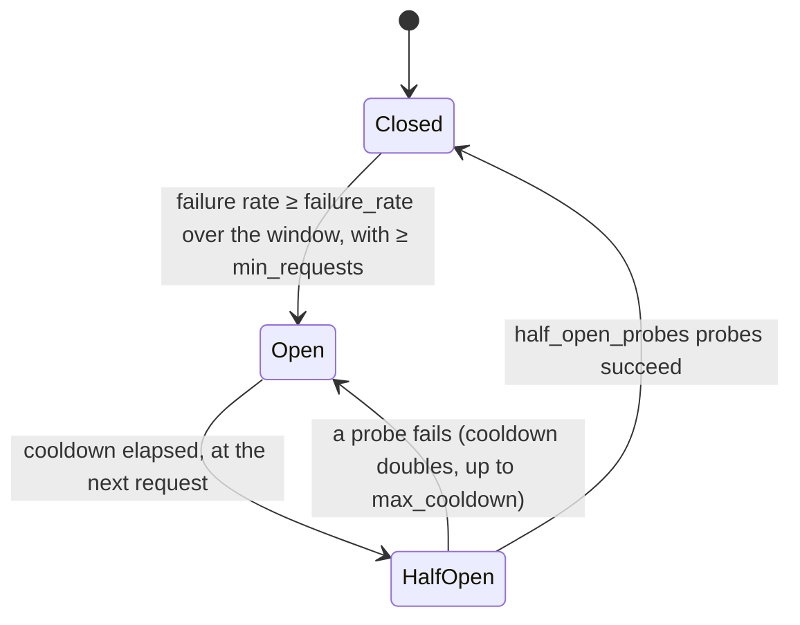

# Routing and reliability

`config/routing.yaml` decides where each request goes and what happens when a provider
fails. This page is the reference for that file and for the reliability behaviour behind
it: retries, fallback, circuit breakers, hedging, keep-alive and hot reload.
Provider-specific translation is in [PROVIDERS.md](PROVIDERS.md).

## How a request is served

1. **Resolve.** The request's `model` must be an alias (`smart`) or a concrete
   `provider/model`. Anything else is a 404.
2. **Rules.** The first matching rule may send the request to another alias or to an
   inline route.
3. **Pick the primary.** One of the route's `targets`, by weight, at random or (with
   `sticky`) by a stable hash.
4. **Candidates.** The primary, then the route's `fallbacks` (the primary is not
   repeated). Candidates whose provider is disabled, or that cannot serve the request
   (tools, images, forced `tool_choice`, structured output, prompt size), are dropped.
   With none left, the client gets a 400 naming what is missing, or a 503 if every
   provider is disabled.
5. **Walk.** Candidates are tried in order. The circuit breaker is asked first; an open
   breaker skips the candidate without a call. A failed attempt is retried on the same
   target or moves to the next candidate, depending on what failed (see
   [Failures](#failures)).
6. **Commit.** The first content event from upstream is the commit point. Nothing is
   sent to the client before it, so every failure up to then is invisible: the client
   sees only the candidate that worked. After it, a failure ends the stream with an
   OpenAI-shaped error event, which the OpenAI SDKs raise as `APIError`.

## The file

An abridged example (the shipped `config/routing.yaml` is a complete one):

```yaml
version: 1

defaults:                # every model inherits these
  timeouts: { connect: 2s, first_token: 30s, idle: 30s, total: 600s }
  retry: { max_attempts: 2, base_delay: 250ms, max_delay: 4s, honor_retry_after_up_to: 10s,
           budget_ratio: 0.2, budget_min_retries: 10 }
  breaker: { window: 30s, min_requests: 20, failure_rate: 0.5, cooldown: 30s,
             max_cooldown: 5m, half_open_probes: 3 }
  keepalive_after: 5s

providers:
  anthropic:
    type: anthropic                    # anthropic | openai | ollama
    base_url: https://api.anthropic.com
    api_key_env: ANTHROPIC_API_KEY     # the variable's name; keys never live in this file
    optional: true                     # no key: disable with a warning instead of failing
    retry: { max_attempts: 3 }         # overrides defaults.retry for this provider
    breaker: { cooldown: 10s }         # overrides defaults.breaker for this provider

models:
  anthropic/claude-sonnet-5-5:
    upstream_model: claude-sonnet-5-5
    capabilities: { tools: true, vision: true, forced_tool_choice: false, json_schema: true,
                    json_object: false, max_input_tokens: 1000000, max_output_tokens: 128000 }
    defaults: { max_tokens: 8192 }
    timeouts: { first_token: 60s }     # overrides the provider's, then the defaults

aliases:
  smart:
    targets:                           # the primary is picked from these by weight
      - { model: anthropic/claude-sonnet-5-5, weight: 90 }
      - { model: openai/gpt-5.4-mini, weight: 10 }
    sticky: key                        # none | key | end_user
    fallbacks: [openai/gpt-5.4-mini, anthropic/claude-haiku-5-5]
    hedge: { after: 3s, max_ratio: 0.1 }   # off unless set
    fallback_on_refusal: false

rules:                                 # top to bottom; the first match wins
  - name: short-prompts-go-fast
    when: { model: smart, prompt_tokens: { lt: 300 }, has_tools: false, has_images: false }
    use: { alias: fast }
  - name: sensitive-stays-local
    when: { tags_any: [pii-sensitive] }
    use: { targets: [{ model: ollama/llama3.2 }] }
```

Durations accept `250ms`, `2s`, `5m`, `1h` or a number of seconds. Every section
rejects unknown fields, so a typo is an error with a "did you mean" hint rather than a
setting that is silently ignored.

### `defaults`

| Field | Default | Meaning |
|---|---|---|
| `timeouts.connect` | 2s | TCP and TLS connect, including waiting for a pooled connection |
| `timeouts.first_token` | 30s | Attempt start to the first content event. For embeddings, the whole attempt |
| `timeouts.idle` | 30s | Longest gap between upstream reads after the commit point. Time spent writing to a slow client does not count |
| `timeouts.total` | 600s | The whole request, retries and fallbacks included. The primary candidate's value applies |
| `retry.max_attempts` | 2 | Attempts per candidate, counting the first |
| `retry.base_delay`, `retry.max_delay` | 250ms, 4s | Full-jitter backoff: `random(0, min(max_delay, base_delay × 2^retry))` |
| `retry.honor_retry_after_up_to` | 10s | A `retry-after` up to this long is waited out; a longer one moves to the next candidate |
| `retry.budget_ratio` | 0.2 | Retries per provider and replica are capped at this share of its requests over the last 10 s |
| `retry.budget_min_retries` | 10 | Retries always allowed per 10 s, so a quiet provider can still be retried |
| `breaker.*` | | See [Circuit breakers](#circuit-breakers) |
| `keepalive_after` | 5s | See [Keep-alive](#keep-alive) |

Timeouts merge in three levels: `defaults`, then the provider's `timeouts`, then the
model's. Retry and breaker policies merge in two: `defaults`, then the provider's.
Inconsistent results (for example a `total` shorter than `first_token`) are reported
for the model or provider that produces them.

### `providers` and `models`

Provider fields not listed above (`api_version`, `unsupported_params`, `pool`,
`thinking_passback`) are described in [PROVIDERS.md](PROVIDERS.md). A model's key is
`<provider>/<name>`, and that is also how clients and fallbacks refer to it.
`capabilities` drive the candidate filter:

| Capability | Default | A request needs it when it has |
|---|---|---|
| `tools` | true | `tools` |
| `forced_tool_choice` | true | `tool_choice: "required"` or a named function |
| `vision` | false | an `image_url` part |
| `json_schema` | false | `response_format: {type: json_schema}` |
| `json_object` | true | `response_format: {type: json_object}` |
| `max_output_tokens` | unset | a larger `max_completion_tokens` / `max_tokens` |
| `max_input_tokens` | unset | a larger prompt, estimated as UTF-8 bytes / 4 |

### `aliases`

- **`targets`** and **`weight`** (default 1). With several targets, the primary is
  picked in proportion to weight. A unit test checks the split with a chi-square test.
- **`sticky`**:
  - `none` (default) picks at random per request.
  - `key` hashes the API key, so each key always gets the same primary.
  - `end_user` hashes the request's `user` field. Without one, the pick is random.

  The hash is of the key's id, so rotating a key may move its traffic.
- **`fallbacks`**: concrete models tried after the primary, in order. They cannot
  reference aliases, so chains cannot loop.
- **`hedge`**: see [Hedging](#hedging). It needs at least one fallback.
- **`fallback_on_refusal`**: see [Refusals](#refusals).

An alias cannot mix chat and embedding models. Embeddings use aliases the same way:
retries, fallbacks and breakers apply, without hedging or a commit point.

### `rules`

A rule has a `name`, a `when` and a `use`. Every condition set in `when` must hold, and
an empty `when` matches every request (later rules are then reported as unreachable).

| `when` field | Matches when |
|---|---|
| `model` | the requested alias or model is this one |
| `key`, `team` | the virtual key's name, or its team's name |
| `tags_any`, `tags_all` | the request's tags include any / all of these |
| `prompt_tokens` | the estimated prompt size satisfies `lt` / `lte` / `gt` / `gte` |
| `has_tools`, `has_images`, `stream` | the request has tools, has image input, streams |

`use` is either `{ alias: <name> }` or an inline route with the alias fields `targets`,
`fallbacks`, `sticky`, `hedge` and `fallback_on_refusal`. Rules apply only to requests
for a known alias or model; an unknown name is a 404 before any rule runs. Metrics keep
the requested alias as their `alias` label, and the access log adds `rule` and `route`.

Tags come from the `X-Switchboard-Tags` header: comma-separated, at most 32 tags of up
to 64 characters each, added to the key's own tags (`create-key --tags`). The shipped
config has
one example rule: `X-Switchboard-Tags: via-claude` on the `fake` alias routes through
the Anthropic translation instead.

## Failures

Every upstream failure has a kind. The kind decides whether the same candidate is retried,
whether the walk may continue to the next one, and whether it counts against the
breaker. The table lives in `src/switchboard/reliability/policy.py` and every row has a
unit test.

| Failure | Retry same target | Next candidate | Breaker |
|---|---|---|---|
| Connect, DNS or TLS error | yes | yes | counts |
| Timeout before the commit point (connect, first token) | once | yes | counts |
| 429 rate limited | if `retry-after` ≤ `honor_retry_after_up_to` | yes | counts |
| Quota or spend limit exhausted | no | yes | counts |
| 5xx, Anthropic 529, an error event before content | yes | yes | counts |
| Malformed or truncated response before content | yes | yes | counts |
| 401 / 403 (the gateway's provider key is rejected) | no | yes | counts, and logs an error |
| Context length exceeded | no | only to a candidate with a larger `max_input_tokens` | no |
| Other 4xx | no | no: returned to the client | no |
| Request the adapter cannot express for this provider (never sent) | no | yes | no |
| Breaker open | no call is made | yes | no |
| Refusal before content | no | only with `fallback_on_refusal` | no |
| Any failure after the commit point | no | no: in-stream error event | counts if it was the provider's fault |

A provider's `x-should-retry` header overrides the "retry" column. A retry is skipped if:

- the provider's retry budget is spent;
- its backoff would cross the request deadline;
- it would follow a failed half-open probe.

When every candidate fails, the client gets the last upstream error. A 400 that stops
the walk is returned as is, and `retry-after` is passed on for a 429. If every breaker
was open, the client gets 503 `upstream_circuit_open`.

## Circuit breakers

There is one breaker per `provider/model`.



- Outcomes are counted in 10 buckets across `window`, so the window slides in steps of
  a tenth of its length.
- **Success** is recorded at the commit point: the provider answered.
- **Half-open** lets exactly `half_open_probes` requests through, even across replicas.
  The rest skip the candidate until the probes report. A probe round that never reports
  (the replica died, the client hung up) restarts after one cooldown.
- **State lives in Redis** (`sb:cb:{provider/model}`, two Lua scripts) when
  `SWITCHBOARD_REDIS_URL` is set, so every replica sees one breaker.
- **Each replica keeps a local view**, updated from every Redis reply. A closed or still-open
  breaker is decided locally with no Redis round trip; only an expired open breaker and
  half-open probing ask Redis. Outcomes are written in the background. A replica learns
  that another replica opened a breaker from the reply to its own next outcome.
- **Without Redis, or while Redis is failing**, each replica uses an in-process breaker
  with the same state machine, and retries Redis after 5 s. One scenario table tests both
  stores (`tests/breaker_cases.py`). See [ADR-0004](adr/0004-redis-shared-state.md).

## Hedging

With `hedge: { after: 3s }`, if the primary has not produced a first token after 3 s,
the remaining candidates start in parallel.

- The first to commit wins. The other is cancelled, which closes its upstream
  connection.
- There is at most one hedge per request, and at most `max_ratio` of the route's
  requests (default 0.1) hedge, per replica over 10 s. One hedge per window is always
  allowed.
- If the primary fails before `after`, the fallbacks run in sequence as usual.
- Hedging is off by default: it can double the cost of slow requests, and providers may
  bill the input of a cancelled request.

Metric: `switchboard_hedges_total{outcome=won|lost|skipped}`.

## Keep-alive

A streaming request with no first token after `keepalive_after` (default 5 s) gets its
`200` status line and then an SSE comment (`: ping`) every `keepalive_after`. Proxies
and load balancers then don't close the connection while a model thinks, and SDK
parsers ignore the comments.

Failover keeps working during the pings. Two things change once they start:

- A total failure is reported as an in-stream error event instead of an HTTP error.
- The `x-switchboard-provider`, `-model`, `-attempts`, `-fallback` and `-dropped-params`
  headers are not sent, because they were not known when the status line went out. The
  chunks' `model` field still names the model that answered.

Non-streaming requests get no keep-alive.

## Refusals

A model that refuses before producing anything (an OpenAI refusal delta, an Anthropic
`stop_reason: "refusal"`) has still answered, so by default the refusal is the response
(`finish_reason: "content_filter"`). With `fallback_on_refusal: true`, the next
candidate is tried instead. The first refusal is held open and served only if no other
candidate commits. A refusal that comes after content has started cannot be undone.

## Hot reload

The config reloads without a restart:

- **File watch:** the file is read every `SWITCHBOARD_CONFIG_WATCH_SECONDS` (default
  1 s) and reloaded when its bytes change. It compares contents rather than relying on
  file events or modification times, so every edit is seen on every file system. That
  covers Docker bind mounts, file systems with one-second timestamps, and Kubernetes
  ConfigMaps, which swap a symlink. See [ADR-0013](adr/0013-config-reload-by-content.md).
- **`SIGHUP`:** `make reload` sends it to every gateway container.
- **The admin endpoint** comes with the admin API in Phase 6.

A reload parses, validates, builds a new routing table and swaps it in one step.

- **Requests in flight** finish on the config they started with.
- **An invalid file changes nothing:** every problem is logged once (`config.reload_failed`,
  with line numbers) and the old config keeps serving.
- **Provider connection pools are reused** when a provider's settings and key are
  unchanged. A replaced pool is closed after the old config's longest `total` timeout,
  so streams still using it can finish.
- **The active config's hash** is in `/ready` (`config_version`) and in the
  `switchboard_config_info{version}` metric.
- **Every reload is counted** in `switchboard_config_reloads_total{trigger, result}`,
  where `result` is `success`, `unchanged` or `error`.

## Validation

Startup, `switchboard validate-config` and every reload run the same checks, and report
every problem at once with its line:

- **Schema:** types, ranges and unknown fields.
- **References:** every alias target, fallback and rule reference exists.
- **Consistency:** merged timeouts and policies are consistent; aliases don't mix chat
  and embedding models; rule names are unique.
- **Hedging:** a hedge has a fallback, and its `after` is shorter than the first-token
  timeout. The second is a warning.
- **Keys:** each required `api_key_env` is set.

Warnings cover a disabled optional provider, an alias whose every candidate is disabled,
and an unreachable rule. A real run:

```text
$ switchboard validate-config broken.yaml
Invalid routing config broken.yaml (2 problems):
  - line 9, aliases.fast.hedge: hedging needs at least one fallback to hedge to
  - line 12, rules[0].when.model: no alias or model named 'fsat' (did you mean 'fast'?)
```

## Observability

**Response headers:**

| Header | Meaning |
|---|---|
| `x-switchboard-provider`, `x-switchboard-model` | The candidate that served the request, or the last one tried if none did |
| `x-switchboard-attempts` | Upstream calls made, retries included |
| `x-switchboard-fallback: true` | A candidate other than the primary served it |

**Metrics** (all `_total` counters except the gauge):

| Metric | Labels |
|---|---|
| `switchboard_attempts` | `provider`, `model`, `outcome` (`success`, an error kind, `circuit_open`, `refusal`, `cancelled`, `skipped`) |
| `switchboard_retries` | `provider`, `model`, `reason` |
| `switchboard_retry_budget_exhausted` | `provider` |
| `switchboard_fallbacks` | `alias`, `from_model`, `to_model`, `reason` |
| `switchboard_hedges` | `alias`, `outcome` |
| `switchboard_breaker_state` (gauge) | `model`: 0 closed, 1 half-open, 2 open, as this replica last saw it |
| `switchboard_breaker_transitions` | `model`, `state` |
| `switchboard_config_reloads` | `trigger`, `result` |

**Access log:** each request's line adds `attempts` and, when anything other than one
clean attempt happened, `attempt_log` (for example
`["fake-flaky/fake-claude-flaky:overloaded:503", "fake/fake-chat:success"]`). It also
adds `rule`, `route`, `fallback` and `hedged` when they apply.

## Try failover locally

The shipped config has a `fake-fallback` alias. Its primary, `fake-flaky/fake-claude-flaky`,
goes through the Anthropic translation to the fake provider, with no retries and a
breaker that trips after 5 requests and cools down for 3 s. Its fallback is the fake
OpenAI model. The fake provider's control API is published on `127.0.0.1:7800`. With
the stack up (`make up`):

```bash
KEY="$(grep '^SWITCHBOARD_DEMO_KEY=' .env | cut -d= -f2-)"
ask() {
  curl -s -D - -o /dev/null http://127.0.0.1:7080/v1/chat/completions \
    -H "authorization: Bearer $KEY" -H 'content-type: application/json' \
    -d '{"model": "fake-fallback", "messages": [{"role": "user", "content": "hi"}]}' \
    | grep -iE '^x-switchboard-(model|attempts|fallback)' | tr -d '\r' | tr '\n' ' '; echo
}

# Break the primary: every request to it now gets a 503.
curl -s -X PUT http://127.0.0.1:7800/_control/behavior \
  -d '{"fault": "status", "status": 503, "fault_models": ["fake-claude-flaky"]}'
for i in 1 2 3 4 5 6; do ask; done

# Heal it, wait out the cooldown, and watch the probes close the breaker.
curl -s -X DELETE http://127.0.0.1:7800/_control/behavior
sleep 3.2; for i in 1 2 3; do ask; done
```

Output from a run on 2026-11-27:

```text
x-switchboard-model: fake/fake-chat x-switchboard-attempts: 2 x-switchboard-fallback: true
x-switchboard-model: fake/fake-chat x-switchboard-attempts: 2 x-switchboard-fallback: true
x-switchboard-model: fake/fake-chat x-switchboard-attempts: 2 x-switchboard-fallback: true
x-switchboard-model: fake/fake-chat x-switchboard-attempts: 2 x-switchboard-fallback: true
x-switchboard-model: fake/fake-chat x-switchboard-attempts: 2 x-switchboard-fallback: true
x-switchboard-model: fake/fake-chat x-switchboard-attempts: 1 x-switchboard-fallback: true
x-switchboard-model: fake-flaky/fake-claude-flaky x-switchboard-attempts: 1
x-switchboard-model: fake-flaky/fake-claude-flaky x-switchboard-attempts: 1
x-switchboard-model: fake-flaky/fake-claude-flaky x-switchboard-attempts: 1
```

- **Requests 1–5:** the primary fails and the fallback answers (2 attempts each).
- **Request 6:** the breaker is open, so the primary is skipped without a call (1 attempt).
- **After the cooldown:** two probes succeed and close the breaker.

`switchboard_breaker_state{model="fake-flaky/fake-claude-flaky"}` in Prometheus
(`127.0.0.1:7090`) shows the same story. `tests/integration/test_stack.py` runs this
sequence in CI.
